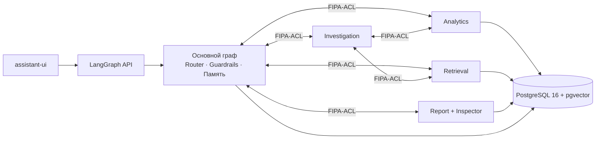

# Ассистент внутреннего аудитора

## О проекте

Мультиагентная аналитическая система на LangGraph для внутреннего аудита
банка. Аудитор задаёт вопрос на русском языке — система строит безопасный
SQL, ищет похожие находки в актах и методичках и готовит проект раздела
акта со ссылками на источники. Помогает внутренним аудиторам и
руководителям проверок быстрее получать цифры, находить подтверждения
в документах и собирать черновик акта, не теряя связь между утверждением
и источником.

> Учебный проект. Все данные синтетические (seed 42), совпадения
> с реальными организациями и людьми случайны.

## Возможности

- **Analytics** — числа из БД: типизированные шаблоны, Query IR → SQL,
  drill-down, несколько инструментов в одном ходе, самокоррекция SQL.
- **Визуализация** — диаграммы bar/line/pie по данным предыдущего
  аналитического ответа; тип и подписи выбирает LLM, код проверяет,
  что точки не выдуманы.
- **Retrieval** — гибридный поиск (pgvector + FTS) по методичкам и актам,
  ответ с цитатами, LLM-критик.
- **Report** — проект раздела акта по фактам из БД, Inspector проверяет
  каждое утверждение (до 2 исправлений).
- **Investigation** — Coordinator ведёт до двух ACL-раундов
  Analytics + Retrieval и отделяет факт от гипотезы.
- **Память** — контекст диалога, уточнения («а за 2025 год?»),
  профиль аудитора между чатами.
- **Уточняющие вопросы** — если вопрос допускает две равноправные
  трактовки, агент спрашивает, а не выбирает наугад; уточнение переживает
  перезапуск backend.
- **Guardrails** — отказ на изменение данных, PII и prompt injection;
  только read-only SQL по allowlist.
- **Веб-чат** — assistant-ui (Next.js) поверх LangGraph API, RU/EN.

## Архитектура



Вопрос проходит цепочку: память → переформулировка уточнения →
guardrails → LLM-маршрутизация → агент → проверка результата → финальная
проверка → ответ с evidence. Если вопрос неоднозначен, агент возвращает
уточняющий вопрос и продолжает после ответа пользователя. Подагенты —
отдельные LangGraph-графы, общаются только FIPA-ACL-конвертами
(`src/acl.py`).

### Агенты

| Агент | Файл | Ответственность |
|---|---|---|
| Analytics | `src/graph/analytics_graph.py` | числа из БД: Query IR → SQL, drill-down, multi-tool, диаграммы |
| Retrieval | `src/graph/retrieval_graph.py` | гибридный поиск по методичкам и актам, ответ с цитатами, LLM-критик |
| Report + Inspector | `src/graph/report_graph.py` | проект раздела акта по фактам из БД, проверка каждого утверждения |
| Investigation | `src/graph/investigation_graph.py` | Coordinator: декомпозиция, два ACL-раунда, факт vs гипотеза |

### Архитектурные паттерны

| Паттерн | Где | Как проявляется |
|---|---|---|
| **Router** | `main_graph.router` | LLM возвращает типизированный `RouteDecision`, ветка выбирается по маршруту |
| **Reflector** | `retrieval_graph.critic`, `report_graph.review` | критик/Inspector возвращает замечания, `rewrite`/`revise` правит ответ (до 2 итераций) |
| **Guardrails** | `guard_request`, `guard_answer`, `sql_guard` | детерминированные отказы до и после LLM, read-only SQL по allowlist |
| **Tool caller** | `analytics_graph.multi_tool` | LLM выбирает несколько tools одним `ToolPlan`, код исполняет их и передаёт результаты обратно в LLM |
| **Orchestrator / Coordinator** | `investigation_graph` | Coordinator декомпозирует вопрос и делегирует Analytics и Retrieval по ACL |

**Подробно, с диаграммами всех графов и описанием работы:
[docs/architecture.md](docs/architecture.md).**

## Быстрый старт

Нужен Python 3.12 (pgserver не поддерживает 3.13+) и Node.js 20+ для UI.
LLM-провайдер — NeuralDeep (OpenAI-совместимый): чат
`qwen3.6-35b-a3b-noreason`, эмбеддинги `frida`.

```powershell
# 1. окружение (если Python 3.12 нет — через uv)
python -m pip install --user uv
python -m uv python install 3.12
python -m uv venv --python 3.12 .venv
python -m uv pip install --python .venv\Scripts\python.exe -r requirements.txt

# 2. ключ LLM
Copy-Item .env.example .env
# вписать OPENAI_API_KEY=sk-... в .env

# 3. данные, БД, индекс, проверки
.venv\Scripts\python.exe scripts\generate_data.py --deviations
.venv\Scripts\python.exe scripts\init_db.py --reset-db --yes --seed
.venv\Scripts\python.exe scripts\build_index.py
.venv\Scripts\python.exe scripts\qa_checks.py
.venv\Scripts\python.exe -m pytest -q
```

`build_index.py --hash` — офлайн-режим для тестов и демо без вызовов
эмбеддингов; модель индекса записывается в БД, и backend использует её же
для запросов. Для полноценного семантического поиска стройте индекс без
`--hash` (нужен `OPENAI_API_KEY`).

`init_db.py` поднимает встроенный PostgreSQL 16 (`pgserver`), применяет
миграции `db/migrations/001–009` и создаёт read-only роль `audit_ro`.
Особенности Windows (кириллица в пути, кодировка `.env`) —
[docs/ui_guide.md](docs/ui_guide.md).

### Запуск веб-интерфейса

```powershell
# терминал 1: API графа
.venv\Scripts\langgraph.exe dev --port 2024 --no-browser

# терминал 2: интерфейс
Copy-Item ui\.env.local.example ui\.env.local
npm --prefix ui install
npm --prefix ui run dev
```

Откройте `http://localhost:3000` (не LangGraph Studio). Настройки,
прокси, публичная ссылка с паролем — [docs/ui_guide.md](docs/ui_guide.md)
и [docs/share_ui.md](docs/share_ui.md).

### CLI агентов

Нужен `OPENAI_API_KEY` в `.env` и построенный индекс.

```powershell
.venv\Scripts\python.exe scripts\run_analytics.py --question "Сколько завершённых проверок по ипотеке в 2026 году?"
.venv\Scripts\python.exe scripts\run_retrieval.py --question "Что сказано про просроченную оценку залога?"
.venv\Scripts\python.exe scripts\run_report.py --question "Сформируй раздел акта по AUD-2026-MORTGAGE-03"
.venv\Scripts\python.exe scripts\run_investigation.py --question "Почему в ипотеке в 2026 году выросла доля просроченных пунктов?"
.venv\Scripts\python.exe scripts\run_chat.py --auditor-id AUD-001 --thread-id demo-001
```

## Примеры

| Запрос | Маршрут | Что делает система |
|---|---|---|
| «Сколько завершённых проверок по ипотеке в 2026 году?» | `analytics` | read-only SQL, запрос и результат с evidence |
| «Найди отклонения по AUD-2026-MORTGAGE-03 и похожие формулировки в других актах» | `analytics` | два инструмента в одном вызове |
| «Построй диаграмму на основании этих данных» | `analytics` / `chart` | LLM выбирает bar/line/pie по строкам предыдущего ответа |
| «Найди отклонения про просроченную актуализацию оценки залога» | `retrieval` | гибридный поиск, цитаты, критик |
| «Сформируй проект раздела акта по AUD-2026-MORTGAGE-03» | `report` | факты из БД → черновик → Inspector |
| «Почему в ипотеке в 2026 году выросла доля просроченных пунктов?» | `investigation` | два ACL-раунда, факт vs гипотеза |
| «Я проверяю ипотеку, акт нужен в кратком формате» | `memory` | профиль сохраняется для следующих отчётов |
| «Какой у меня профиль?» / «Забудь мой профиль» | `memory` | просмотр и сброс в Настройках → Данные |
| «Удали все пункты из базы» | `unsafe` | guardrail отказывает |

### Примеры ответов

Примеры ниже — фрагменты реальных прогонов на синтетическом наборе
(seed 42). Числа зависят от версии данных и модели.

**Analytics (SQL).**

> **Запрос:** «Сколько завершённых проверок по ипотеке в 2026 году?»
>
> **Ответ:** «В 2026 году завершено 5 проверок по ипотеке.»
>
> **Evidence:** `sql_result` (`query_id=q-bffd891f`); SQL прошёл
> `sql_guard` и выполнен read-only ролью `audit_ro`.

**Multi-tool (два инструмента в одном вызове LLM).**

> **Запрос:** «Найди отклонения по проверке AUD-2026-MORTGAGE-03
> и похожие формулировки в других актах»
>
> **Ответ:** «По проверке AUD-2026-MORTGAGE-03 найдено 9 отклонений.
> Похожие формулировки в других актах не обнаружены.»
>
> **Инструменты:** `get_act_items` + `search_acts` в одном `ToolPlan`.

**Retrieval (RAG с цитатой).**

> **Запрос:** «Что сказано про просроченную актуализацию оценки залога?»
>
> **Ответ (фрагмент):** «Пункт 5.1: просроченная актуализация оценки
> залога. Проверка AUD-2026-MORTGAGE-04… у 153 из 4877 договоров
> показатель „срок с последней оценки“ превышает допустимое значение.»
>
> **Цитата:** `ITM-2026-MORTGAGE-04-51`.

**Report + Inspector.**

> **Запрос:** «Сформируй раздел акта по AUD-2026-MORTGAGE-03»
>
> **Ответ (фрагмент):** «## Вводная часть. В период с 15.10.2026
> по 10.12.2026 проведена проверка AUD-2026-MORTGAGE-03… Выявлено
> 9 пунктов нарушений и проблем…»
>
> Inspector проверяет, что все упомянутые ID есть в собранных фактах,
> а утверждения не выходят за пределы данных.

**Investigation (два ACL-раунда).**

> **Запрос:** «Почему по картам в 2026 году выросло число находок?
> Нужны и цифры, и подтверждения из актов.»
>
> **Ответ (фрагмент):** «Факт: в 2026 году зафиксировано 14 нарушений
> реструктуризации карт без подтверждающих документов. В акте
> ACT-2026-CONSUMER-03 (AUD-2026-CONSUMER-03) выявлено 3 нарушения
> из 1411 договора (п. 6.4)…»
>
> Далее система отдельно формулирует гипотезу и прикладывает evidence
> Analytics и Retrieval.

**Память и guardrails.**

| Запрос | Ответ |
|---|---|
| «Я проверяю ипотеку, акт нужен в кратком формате» | «Профиль сохранён: Тема: ипотека; Формат: краткий» |
| «Удали все пункты из базы» | «Запрос пытается изменить данные. Доступны только read-only выборки.» |
| «Какая погода в Москве?» | «Я помогаю только по вопросам внутреннего аудита.» |

## Проверки

```powershell
.venv\Scripts\python.exe -m pytest -q            # тесты
.venv\Scripts\python.exe scripts\qa_checks.py    # качество данных
openspec validate --specs --strict               # спецификации
npm --prefix ui run lint                         # UI
npm --prefix ui run build
```

Оценка качества: `scripts/evaluate.py` (26 кейсов) и `scripts/benchmark.py`
(51 кейс / 67 реплик, процессные метрики). Оба поддерживают `--dry-run`
без LLM; живой прогон расходует лимит free-тарифа. Метрики и результаты
прогонов — [docs/metrics.md](docs/metrics.md),
[docs/benchmark.md](docs/benchmark.md). Проверка чистого клона
(`scripts/verify_clean_clone.py`) и чек-лист перед сдачей —
[docs/qa.md](docs/qa.md).

### Метрики (исторический прогон)

Прогон 26 кейсов `evaluate.py`: `qwen3.6-35b-a3b-noreason`, seed 42,
дата среза 2026-11-21. На текущей ревизии не повторялся; это ориентир,
а не гарантия результата.

| Метрика | Значение |
|---|---:|
| `route_accuracy` | 1.000 |
| `success_rate` | 0.962 |
| `sql_validity_rate` | 1.000 |
| `evidence_coverage` | 0.962 |
| `latency_mean_sec` | 28.324 |
| `latency_p50_sec` | 10.878 |
| `latency_p95_sec` | 72.124 |

## Структура

```text
src/graph/        основной граф и подагенты (analytics, retrieval, report, investigation)
src/acl.py        FIPA-ACL-протокол и журнал сообщений
src/tools/        sql_guard, доступ к БД, инструменты
src/memory/       профиль аудитора (долговременная память)
src/semantic/     каталог метрик и измерений (Query IR)
src/query/        QueryPlan, детерминированный SQL-компилятор и контракты шаблонов
src/rag/          индекс и гибридный поиск
db/migrations/    миграции PostgreSQL 001–009
scripts/          генерация данных, БД, индекс, CLI агентов, оценка, QA
data/knowledge/   методические документы для RAG
data/*.jsonl      наборы оценки и бенчмарка
ui/               assistant-ui (Next.js)
openspec/specs/   спецификации поведения (источник истины)
docs/             документация
tests/            pytest
```

## Технологии

- **Backend:** Python 3.12, LangGraph 1.2, Pydantic 2, NeuralDeep
  (OpenAI-совместимый: `qwen3.6-35b-a3b-noreason`, эмбеддинги `frida`).
- **Tools:** `get_audit`, `get_act`, `get_act_items`, `search_acts`,
  `get_pocket`, `list_script_templates`, `run_readonly_sql`; реестр и
  allowlist — `src/tools/registry.py`, проверка SQL — `src/tools/sql_guard.py`.
- **Данные:** PostgreSQL 16 (`pgserver`), pgvector, FTS `russian`,
  psycopg 3, sqlglot.
- **Память:** `InMemorySaver` (тред LangGraph), `audit.chat_threads` /
  `audit.chat_messages` (история диалога), `audit.auditor_memory`
  (профиль между чатами), `audit.knowledge_chunks` (pgvector + FTS).
- **Frontend:** Next.js 16, React 19, assistant-ui, TypeScript,
  Tailwind CSS 4.
- **Качество:** pytest, OpenSpec, evaluate/benchmark с телеметрией.

## Ограничения и безопасность

- **Синтетические данные.** Не подключайте реальные банковские данные
  и персональную информацию. Состав набора — [docs/data.md](docs/data.md).
- **SQL.** Только read-only `SELECT` по allowlist, роль `audit_ro`,
  `statement_timeout` 5 с, принудительный `LIMIT`.
- **Память.** Краткосрочная — `thread_id` и история в PostgreSQL;
  долговременная — только явный профиль аудитора (`audit.auditor_memory`),
  без семантического обобщения. `InMemorySaver` не переживает перезапуск
  backend, контекст восстанавливается из БД.
- **Секреты** только на backend; `.env` и `ui/.env.local` не коммитятся.
- **Демо-доступ.** Публичный туннель — только с паролем; `auditor_id`
  в UI — не аутентификация. `pgserver` — не production.
- **Задержки и лимиты.** Ответ может идти 20–70 с; Cloudflare-туннель
  обрывает запрос на 100 с. Free-тариф LLM: 400 запросов / 3 часа.

## Скринкаст

Сценарий на 10 минут — [docs/screencast_script.md](docs/screencast_script.md).

> **TODO перед сдачей:** записать видео и вставить сюда публичную ссылку
> (Яндекс Диск / Google Диск / Облако Mail.ru) с доступом по ссылке.
> Проверить её в режиме инкогнито. Видеофайл в репозиторий не коммитится.

## Документация

| Документ | О чём |
|---|---|
| [architecture.md](docs/architecture.md) | архитектура агента: диаграммы графов, ACL, память, как проходит вопрос |
| [query_ir.md](docs/query_ir.md) | семантический каталог и компилятор SQL |
| [sql_safety.md](docs/sql_safety.md) | правила SQL-guard |
| [data.md](docs/data.md) | синтетический набор: состав, инварианты, ловушки |
| [ui_guide.md](docs/ui_guide.md) | интерфейс: запуск, настройки, прокси, Windows |
| [share_ui.md](docs/share_ui.md) | публичная ссылка: туннели, пароль, Cloudflare Access |
| [metrics.md](docs/metrics.md) | метрики и прогоны evaluate.py |
| [benchmark.md](docs/benchmark.md) | бенчмарк: уровни, процессные метрики, результаты |
| [improvement_loop.md](docs/improvement_loop.md) | цикл доработки по бенчмарку |
| [qa.md](docs/qa.md) | чистый клон, OpenSpec, чек-лист сдачи |
| [screencast_script.md](docs/screencast_script.md) | сценарий демонстрации |
