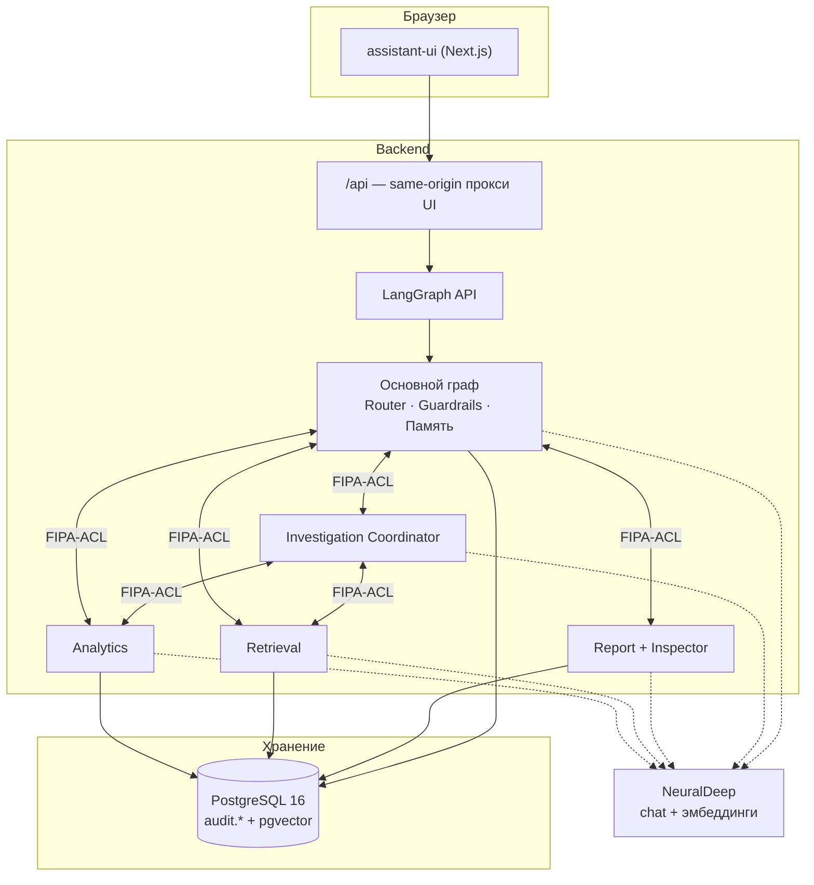
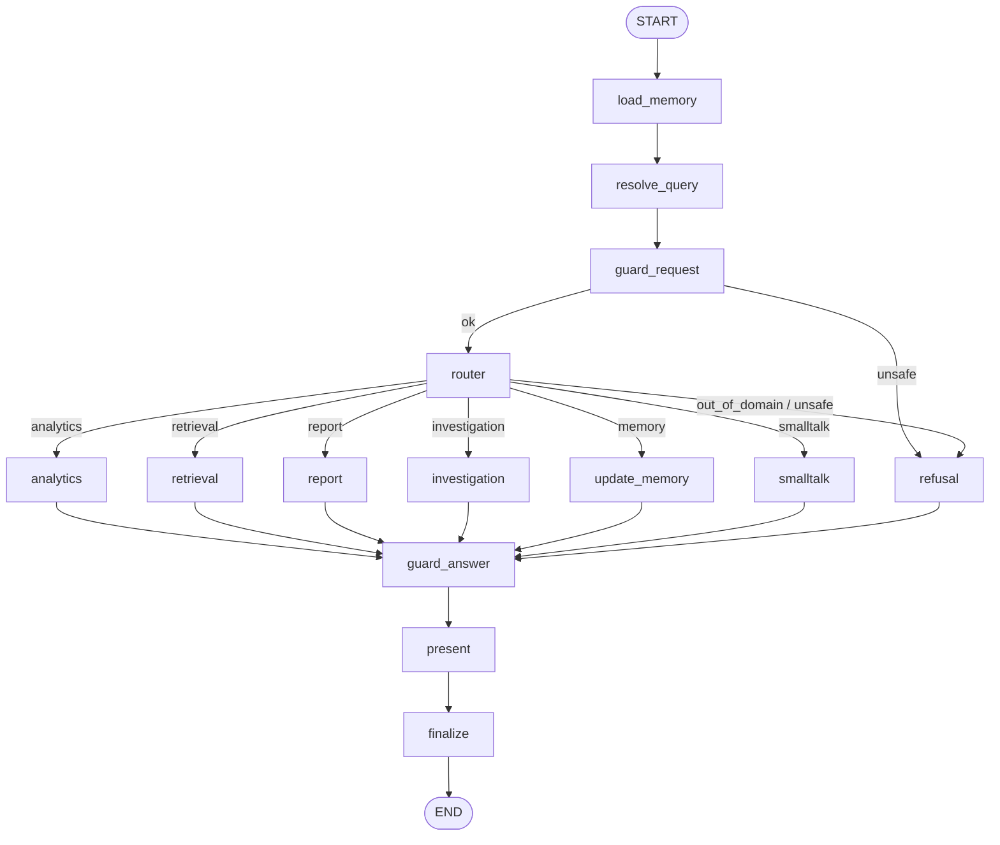
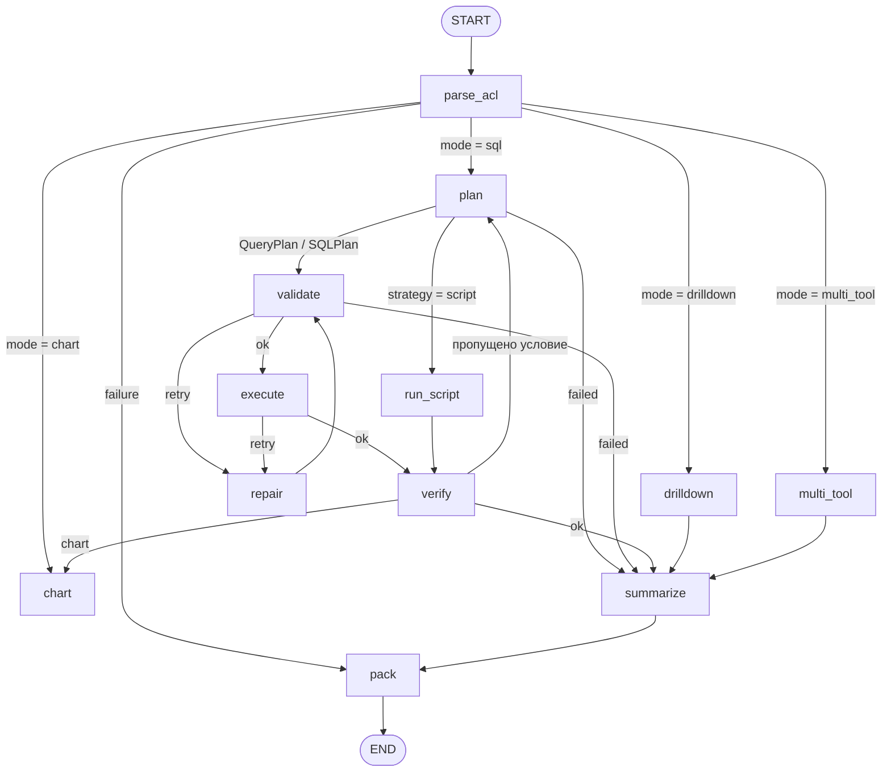
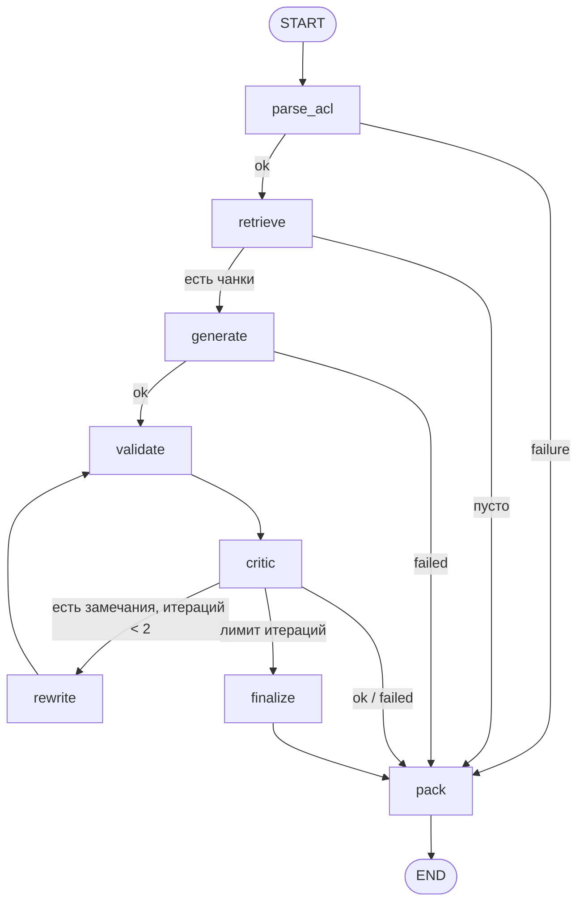
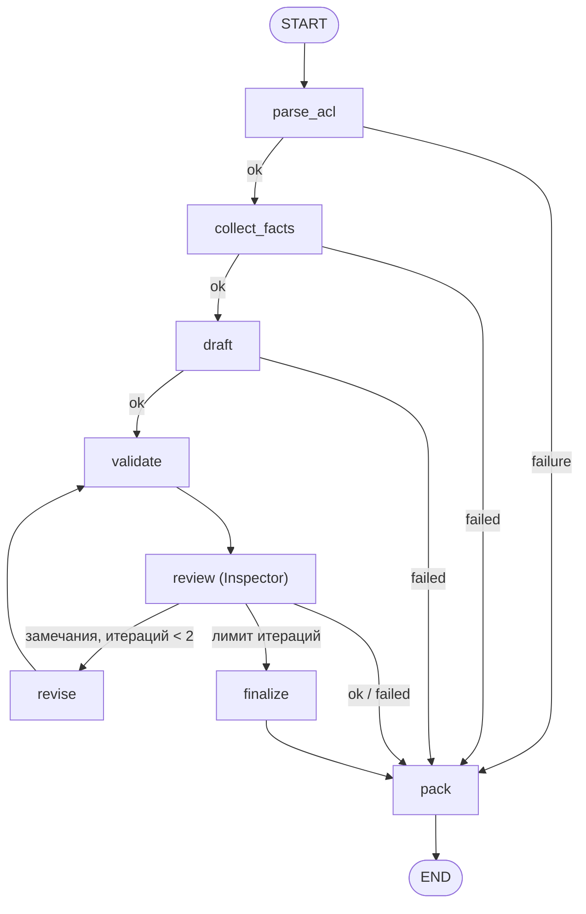
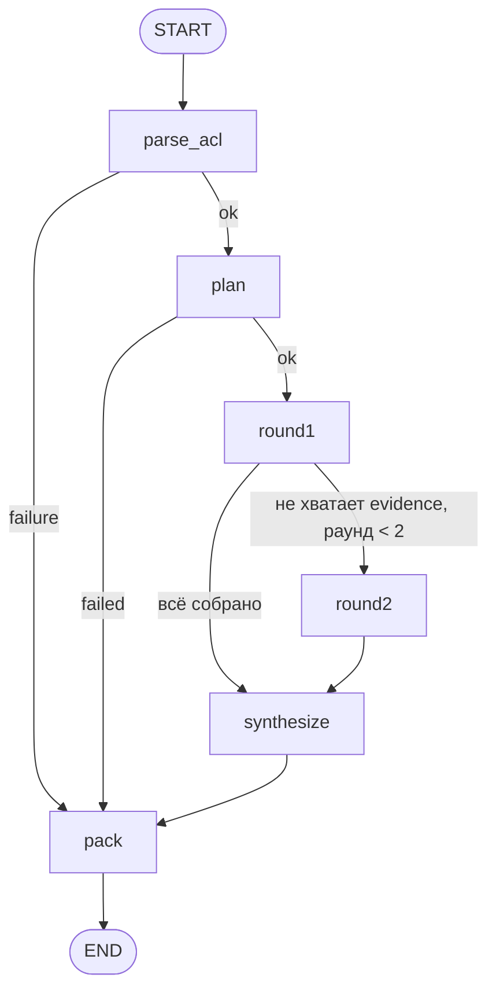
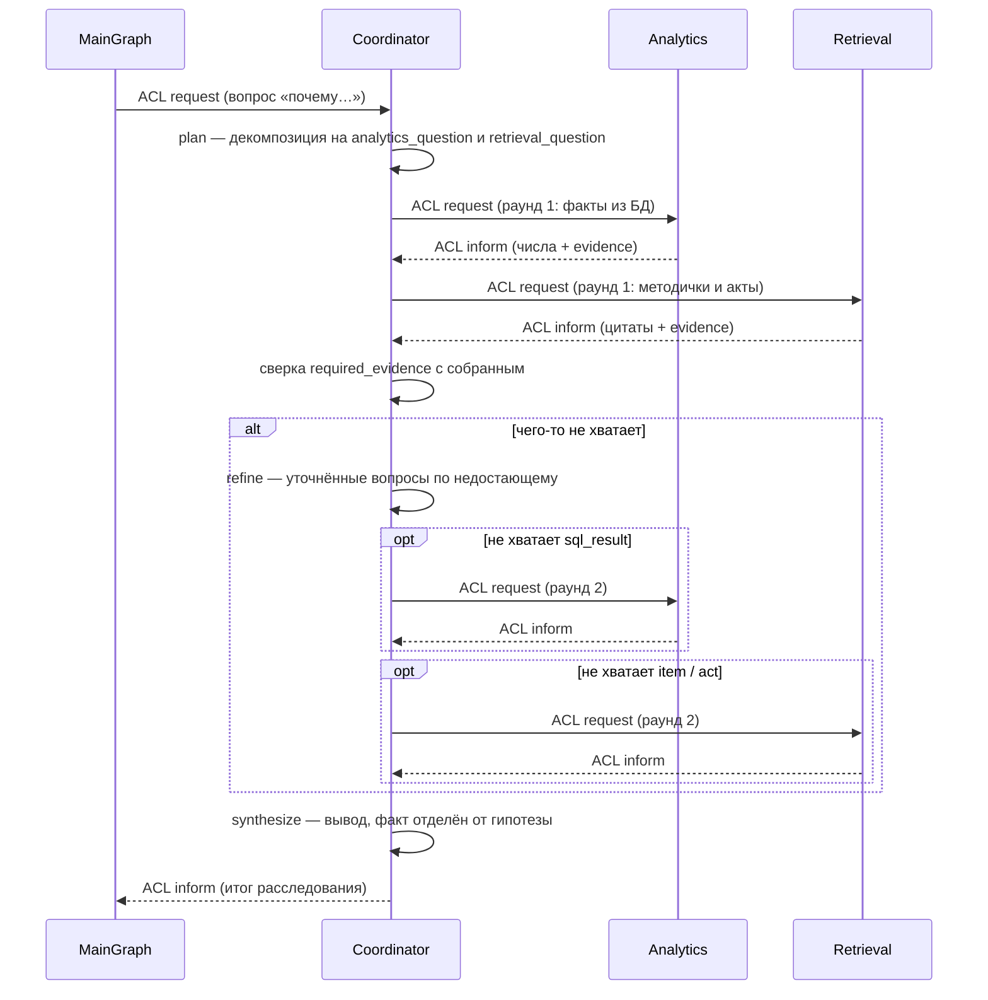

# Архитектура агента

Как устроена мультиагентная система: графы, агенты, протокол общения,
память и путь одного вопроса от пользователя до ответа.

## Общая схема



Ключевые принципы:

- **Один вход.** Пользовательский вопрос всегда проходит основной граф:
  память → переформулировка → guardrails → маршрутизация → ветка →
  финальная проверка → ответ.
- **Агенты — отдельные графы.** Analytics, Retrieval, Report и
  Investigation живут в собственных LangGraph-подграфах
  (`src/graph/*_graph.py`) и вызываются только ACL-сообщениями,
  а не прямыми вызовами бизнес-функций.
- **LLM не пишет SQL напрямую.** Analytics строит типизированный план
  запроса, а SQL собирает детерминированный компилятор; каждый SQL
  проходит `sql_guard` и выполняется read-only ролью.
- **Каждый факт со ссылкой.** Ответы несут evidence (ID строк БД,
  SQL-результаты) или цитаты из документов; Report и Retrieval
  дополнительно проверяются критиком/инспектором.

### Архитектурные паттерны

| Паттерн | Где | Как проявляется |
|---|---|---|
| **Router** | `main_graph.router` | LLM возвращает типизированный `RouteDecision`, ветка выбирается по маршруту |
| **Reflector** | `retrieval_graph.critic`, `report_graph.review` | критик/Inspector возвращает замечания, `rewrite`/`revise` правит ответ (до 2 итераций) |
| **Guardrails** | `guard_request`, `guard_answer`, `sql_guard` | детерминированные отказы до и после LLM, read-only SQL по allowlist |
| **Tool caller** | `analytics_graph.multi_tool` | LLM выбирает несколько tools одним `ToolPlan`, код исполняет их и передаёт результаты обратно в LLM |
| **Orchestrator / Coordinator** | `investigation_graph` | Coordinator декомпозирует вопрос и делегирует Analytics и Retrieval по ACL |

## Основной граф

Код: `src/graph/main_graph.py`.



### Как проходит вопрос

1. **`load_memory`** — загружает профиль аудитора из `audit.auditor_memory`
   по `auditor_id` и собирает `dialogue_context` (последние реплики):
   сначала из `audit.chat_messages` по стабильному `conversation_id`,
   затем из сообщений LangGraph-треда, в крайнем случае — из
   `client_history`, присланного UI. Не более 12 сообщений / 6000 символов.
2. **`resolve_query`** — LLM переформулирует уточнения («а за 2025 год?»,
   «а по картам?») в самостоятельный вопрос с учётом контекста. Результат
   кладётся в `resolved_query`, исходный текст остаётся в `user_query`.
3. **`guard_request`** — детерминированная проверка обоих текстов вопроса:
   запросы на изменение данных, PII и prompt injection получают маршрут
   `unsafe` ещё до Router.
4. **`router`** — LLM возвращает типизированное `RouteDecision`
   (`analytics`, `retrieval`, `report`, `investigation`, `memory`,
   `smalltalk`, `out_of_domain`). Жёстких доменных эвристик нет: решение
   «это запрос на память?» принимает LLM, поэтому смешанная реплика
   («Я проверяю ипотеку, сколько проверок?») не попадает в `memory` и не
   теряет аналитическую часть вопроса. Если LLM недоступна, fallback
   возвращает `out_of_domain` и не угадывает доменный маршрут.
5. **Ветка агента / `update_memory`** — при маршруте `memory` узел
   `update_memory` извлекает предпочтения через `llm.extract_memory`
   (структурированный вывод с whitelist ключей `focus_theme`,
   `default_format`, `signature`), валидирует (`store.normalize_fact`)
   и пишет/удаляет. Значения принимаются только в каноническом виде;
   keyword-fallback `infer_memory` удалён — без LLM профиль не меняется.
   Профиль передаётся всем агентам в ACL-content как блок «Профиль
   аудитора (предпочтения, не условия запроса)»: планеры/суммаризаторы/
   ретриверы из `profile_text` подмешивают его в текст промпта, а не в
   условия вопроса.
6. **Ветка агента** — основной граф упаковывает вопрос в ACL-конверт
   (`request`) и вызывает подграф. В `content` передаются `question`,
   `original_question`, `conversation_context`, `auditor_id`,
   `profile_text`, `language` (для `report_agent` — также
   `report_format` и `signature`).
7. **`guard_answer`** — финальная проверка ответа: приватность,
   безопасность SQL, отсутствие запрещённого содержимого. Для
   фактических маршрутов передаётся evidence: ответ без подтверждения
   помечается, а не выдаётся за факт.
8. **`present`** — формирует ответ на языке вопроса, прикладывает
   evidence/цитаты и шаги `trace`.
9. **`finalize`** — одной транзакцией пишет пару `user + assistant`,
   `trace` и `resolved_query` в `audit.chat_messages`. Повторный запуск
   с тем же `turn_id` не создаёт дублей.

## Протокол общения агентов (FIPA-ACL)

Код: `src/acl.py`. Каждое межагентное взаимодействие — `ACLMessage`:

| Поле | Назначение |
|---|---|
| `performative` | `request`, `inform`, `failure`, `refuse`, `propose`, `agree` |
| `sender` / `receiver` | имена агентов (`orchestrator`, `analytics_agent`, …) |
| `content` | вопрос, `original_question`, `conversation_context`, результат, evidence |
| `conversation_id` / `reply_with` / `in_reply_to` | корреляция запроса и ответа |
| `protocol` / `language` | `fipa-acl`, `ru` |

Все конверты журналируются в JSONL (`logs/`), журнал раундов расследования
хранится в состоянии (`acl_log`). Подграфы начинают работу с узла
`parse_acl`: некорректный конверт сразу даёт `refuse`, а не падение.

## Подагенты

| Агент | Граф | Назначение |
|---|---|---|
| Analytics | `src/graph/analytics_graph.py` | числа из БД: Query IR, шаблоны, drill-down, multi-tool |
| Retrieval | `src/graph/retrieval_graph.py` | поиск по методичкам и актам, ответ с цитатами, критик |
| Report | `src/graph/report_graph.py` | проект раздела акта + Inspector |
| Investigation | `src/graph/investigation_graph.py` | Coordinator: два ACL-раунда, факт vs гипотеза |

### Разбор текста без регулярных выражений

ID, годы, числа, сноски, предложения и абзацы разбирает `src/textscan.py`
обычными строковыми операциями. Регулярные выражения в `src/` остались
только в `src/guardrails.py` — это политика безопасности (блокировка
изменения данных, PII и раскрытия промпта), а не понимание вопроса.

### Analytics



Как работает:

1. **Режим** приходит из router (`analytics_mode`: `sql`, `drilldown`,
   `multi_tool`, `chart`) — LLM выбирает его по смыслу вопроса, а
   `parse_acl` валидирует enum. Режим `chart` выбирает LLM-router по
   смыслу запроса.
2. **`plan`** — двухуровневая стратегия получения SQL:
   - LLM возвращает `QueryPlan(metric, dimensions, filters, template_key)`
     по семантическому каталогу `src/semantic/catalog.py`; шаблон она
     выбирает сама;
   - `review_query_plan` — вторая structured-проверка: LLM возвращает
     `PlanGaps` (чего не хватает плану), а `apply_plan_gaps`
     (`src/query/intent.py`) валидирует и применяет их по каталогу;
   - SQL собирает компилятор `src/query/compiler.py`;
   - выбранный LLM шаблон проверяется по контракту
     (`src/query/templates.py`): метрика, разрезы, фильтры. Шаблон
     запускается только при полном покрытии плана, иначе используется SQL;
   - если план или метрика не поддержаны — fallback на свободный
     `SQLPlan` (только generated SQL).
3. **`validate`** — каждый SQL проходит `sql_guard` (`src/tools/sql_guard.py`):
   только `SELECT`, allowlist таблиц/колонок, принудительный `LIMIT`,
   проверка значений фильтров.
4. **`execute`** — выполнение через read-only роль `audit_ro` со
   `statement_timeout` 5 секунд.
5. **`repair`** — при ошибке LLM получает текст ошибки и исправляет план;
   число попыток ограничено.
6. **`verify`** — LLM сверяет вопрос с выполненным SQL и результатом:
   выписывает условия вопроса и проверяет, где каждое отражено. Если
   конкретное условие не отражено — один раз перестраивает план с
   исправленным вопросом; если трактовка неоднозначна — задаёт уточняющий
   вопрос; иначе ответ помечается как проверенный или честно
   предупреждается о возможной неполноте.
7. **`chart`** — для `analytics_mode=chart` сначала выполняет обычный
   QueryPlan/SQL по текущему вопросу; если план не построен, берёт payload
   предыдущего аналитического ответа (`rows`, `columns`, `question`).
   Затем LLM выбирает `ChartSpec` (bar/line/pie, подписи, точки) и указывает
   для каждой точки `row_index` + `measure`; код берёт значение из строки
   сам. Если валидных точек меньше двух или LLM недоступна, диаграмма не
   показывается — выдаётся честное сообщение. Подробнее —
   [visualization.md](visualization.md).
8. **`summarize`** — LLM возвращает `AnswerDraft(text, numbers_used)`.
   Каждое объявленное число проверяется по строкам и суммам колонок, а
   цифра в тексте, которой нет в `numbers_used`, отклоняет ответ: проверка
   не проходит вхолостую, если модель ошиблась или забыла число. При
   отказе выдаётся детерминированная таблица. **`pack`** упаковывает
   результат в ACL `inform`.

Так модель не придумывает колонки, метрики и способ выполнения:
допустимые измерения и значения проверяются до выполнения, а шаблон
выбирается кодом по контракту. Подробнее —
[query_ir.md](query_ir.md) и [sql_safety.md](sql_safety.md).

### Уточнение вместо догадки

Если проверка плана (`review_query_plan`) или результата (`verify_result`)
видит две равноправные трактовки, агент возвращает в ACL `content`
объект `clarification`, а не число. Основной граф:

1. сохраняет уточнение в `pending_clarification` и в
   `audit.chat_messages.payload`;
2. на следующем ходе разбирает ответ пользователя
   (`resolve_clarification`) и собирает самостоятельный вопрос;
3. при повторной неоднозначности задаёт второй вопрос;
4. после двух уточнений отвечает с явно указанным допущением.

Уточнение переживает перезапуск backend: `load_memory` поднимает его из
истории, если состояние треда потеряно. Спрашивать «наугад» агент не
должен: лучше один короткий вопрос, чем неверное число.

Уточнение — только про бизнес-смысл. Про значения статусов, имена колонок,
«список или количество» и определение периода агент не спрашивает: это
решает каталог или система. Один и тот же вопрос в диалоге не повторяется:
история заданных уточнений передаётся агенту и проверяется кодом.

### Retrieval



Как работает:

1. **`retrieve`** — гибридный поиск по `knowledge_chunks`: pgvector
   (эмбеддинги `frida`) + полнотекстовый поиск PostgreSQL (`russian`),
   объединение и ранжирование результатов. Индекс строится
   `scripts/build_index.py` по методичкам (`data/knowledge/`), пунктам
   и актам.
2. **`generate`** — LLM пишет ответ только по найденным чанкам,
   каждое утверждение помечается цитатой.
3. **`validate`** — детерминированная проверка: все ссылки на цитаты
   существуют среди найденных чанков.
4. **`critic`** — LLM-критик проверяет обоснованность: отвечает ли текст
   на вопрос, подтверждён ли он цитатами. При замечаниях — **`rewrite`**
   (до 2 итераций), затем повторная проверка.
5. **`pack`** — ACL `inform` с ответом, цитатами и evidence.

### Report + Inspector



Как работает:

1. **`collect_facts`** — детерминированно собирает факты из БД по коду
   проверки (`AUD-…`): пункты, скрипты, запуски, отклонения. Если модель
   не перенесла код в переформулировке, берётся последний `AUD-…` из
   контекста диалога.
2. **`draft`** — LLM пишет проект раздела акта только по собранным
   фактам; каждое утверждение ссылается на ID пункта/скрипта.
3. **`validate`** — проверка, что все упомянутые ID существуют.
4. **`review` (Inspector)** — проверяет обоснованность: нет ли
   утверждений без evidence, не приписаны ли данным лишние выводы.
   Замечания уходят в **`revise`** (до 2 исправлений), затем повторная
   проверка; при исчерпании лимита — честный `finalize` с оговорками.

### Investigation (Coordinator)



Coordinator сам не ходит в БД: он декомпозирует вопрос и делегирует
подагентам по ACL. Раунд 1 всегда опрашивает обоих агентов, раунд 2 —
только тех, чьих данных не хватило:



`synthesize` явно маркирует, что подтверждено данными (факт), а что
является предположением (гипотеза), и прикладывает evidence обоих агентов.

## Память и история диалога

| Слой | Где хранится | Что даёт |
|---|---|---|
| Тред LangGraph | `InMemorySaver` (`thread_id`) | состояние графа в рамках процесса |
| История чата | `audit.chat_threads`, `audit.chat_messages` | контекст переживает перезапуск backend |
| Профиль аудитора | `audit.auditor_memory` | тема, формат акта, подпись; извлечение только LLM (без keyword-fallback); блок профиля в промптах подагентов; сброс/удаление ключей — в UI |
| Аварийный fallback | `client_history` из `localStorage` UI | контекст, если потерян и тред, и БД-история |

Ключ истории — стабильный `conversation_id` из UI (`chat.id`), а не
backend `thread_id`: пересоздание треда после перезапуска не теряет
контекст. `dialogue_context` передаётся агентам в ACL-content полем
`conversation_context`, поэтому LLM видит историю, даже если
переформулировка уточнения не удалась. В `trace` появляется шаг
«Уточнение вопроса» с парой «исходный → самостоятельный».

## Guardrails и безопасность SQL

- **`guard_request`** (до Router): детерминированно блокирует изменение
  данных, PII и prompt injection; проверяет и исходный, и
  переформулированный вопрос.
- **`sql_guard`** (`src/tools/sql_guard.py`): только read-only `SELECT`,
  allowlist таблиц и колонок, обязательный `LIMIT`, запрет опасных
  конструкций; валидируется и шаблонный, и свободный SQL.
- **БД**: отдельная read-only роль `audit_ro`, `statement_timeout` 5 с.
- **`guard_answer`** (после агента): финальная проверка ответа перед
  выдачей пользователю.
- **Секреты**: ключ LLM и DSN только на backend; браузерный bundle
  ключей не содержит.

Подробнее — [sql_safety.md](sql_safety.md).

## Данные

PostgreSQL 16 (встроенный `pgserver`), схема `audit`, миграции
`db/migrations/001–009`:

```text
audit_pockets → audits → acts → act_items → scripts
                                          → script_runs → deviations
knowledge_chunks (pgvector + FTS)   auditor_memory
chat_threads → chat_messages        dataset_metadata
```

Состав и инварианты синтетического набора — [data.md](data.md).

## Управление чатами

Служебный граф `dialogue_admin` (`src/graph/admin_graph.py`) выполняет
`rename` и `delete` без LLM:

- UI вызывает его через тот же LangGraph API (`assistant_id=dialogue_admin`);
- `rename` обновляет `audit.chat_threads.title`;
- `delete` удаляет `audit.chat_threads`, `chat_messages` уходят каскадом;
  дополнительно UI удаляет backend-тред через `DELETE /threads/{id}`;
- обе операции проверяют владельца: если у чата записан непустой
  `auditor_id` и он не совпадает с переданным, операция отклоняется;
- история чужого чата не загружается в контекст ответа.

Это defense-in-depth, а не аутентификация: `auditor_id` выбирается в
настройках UI. Реальная защита демо — Basic Auth на публичном туннеле
([share_ui.md](share_ui.md)).

## Ограничения

- `InMemorySaver` не переживает перезапуск backend; контекст
  восстанавливается из `audit.chat_messages` и `client_history`.
- Список чатов в UI хранится в `localStorage`; для истории на другом
  устройстве нужен отдельный API `GET /chats` поверх `chat_threads`.
- Долговременной семантической памяти нет: профиль аудитора — явные
  факты, а не обобщение опыта.
- `pgserver` — встроенный сервер для учебного запуска, не production.
- Данные синтетические, кроме методических документов.

## Связанные документы

- [query_ir.md](query_ir.md) — семантический каталог и компилятор SQL;
- [sql_safety.md](sql_safety.md) — правила SQL-guard;
- [data.md](data.md) — синтетический набор данных;
- [metrics.md](metrics.md), [benchmark.md](benchmark.md) — оценка качества;
- [improvement_loop.md](improvement_loop.md) — цикл доработки по бенчмарку;
- [ui_guide.md](ui_guide.md) — интерфейс и его настройка;
- [share_ui.md](share_ui.md) — публичная ссылка на демо.
