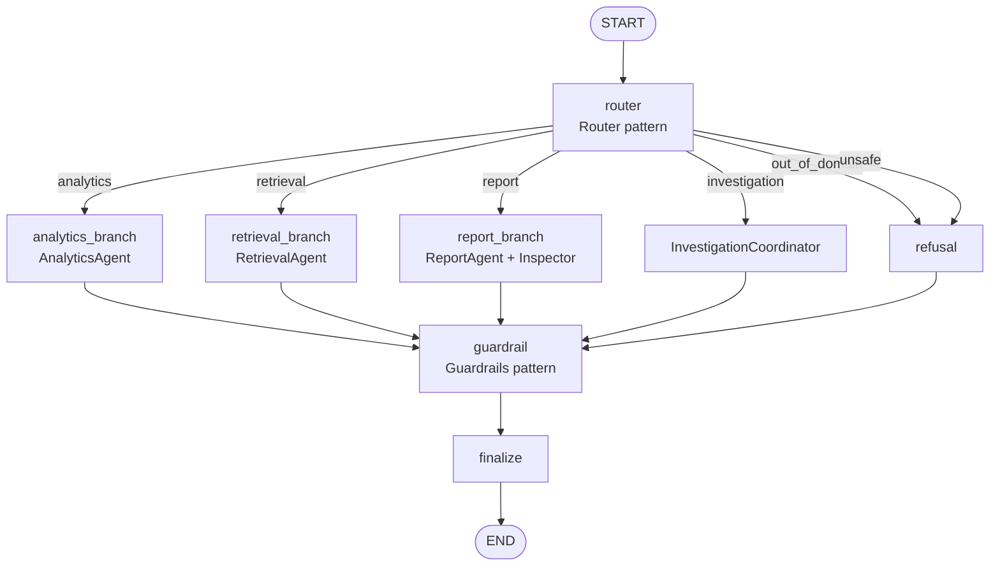
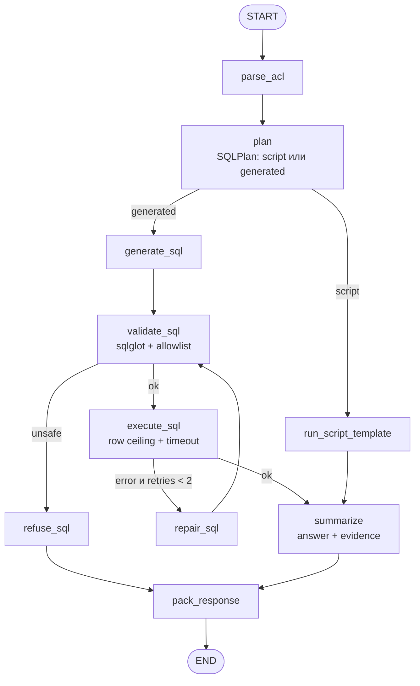
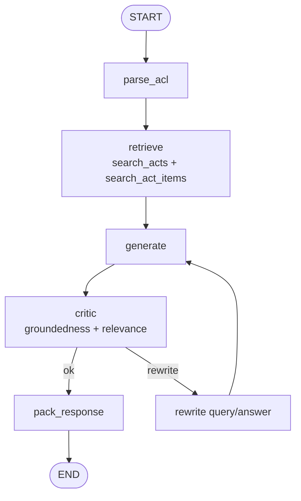
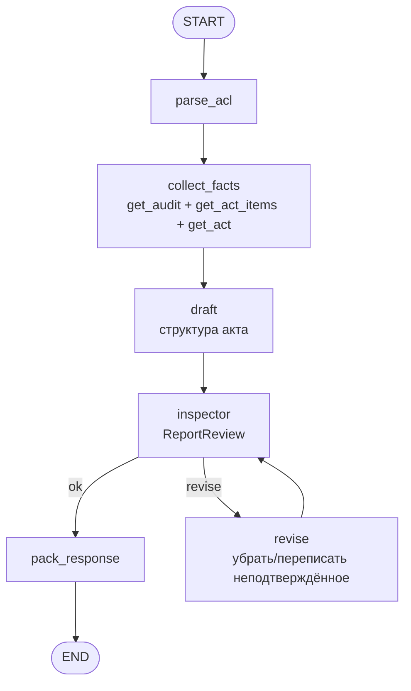
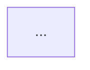

# План выполнения итогового проекта
## «Ассистент внутреннего аудитора» — мультиагентная аналитическая система на LangGraph

> Документ составлен по проектному заданию (PDF, 5 страниц) и 13 ноутбукам из папки `course/`.
> Горизонт: 21 ноября — 2 декабря 2026. Дедлайн сдачи: **2 декабря**. Консультации: **24 и 26 ноября в 19:00**.
>
> **Идея домена** взята из проекта `C:\Users\Алексей\AgentOARB` (навык `audit_analyzer`, таблицы `oarb.*`),
> но это **самостоятельный компактный учебный проект**, а не копия AgentOARB: другой стек, другая
> архитектура, только предметная область и схема данных. Подробнее — раздел 0.3.
>
> Предыдущий вариант плана (e-commerce support) сохранён как `ПЛАН_ПРОЕКТА_ECOMMERCE.md`.

---

## 0. Главное в одном экране

### 0.1. Ключевые решения

| Вопрос | Решение |
|---|---|
| Тема проекта | **Ассистент внутреннего аудитора**: отвечает на аналитические вопросы по карманам, проверкам и находкам, строит безопасный SQL, ищет похожие формулировки в актах, формирует проект акта со ссылками на источники |
| Пользователь | Внутренний аудитор, руководитель отдела аудита, методолог |
| Почему эта тема | Домен хорошо ложится на все 6 обязательных критериев: маршрутизация, NL→SQL, RAG по актам, Reflector-проверка обоснованности, multi-tool, измеримое качество |
| Стек | Python 3.11–3.12, LangGraph 1.2.x, OpenAI SDK 2.x, Pydantic 2.x, **PostgreSQL 16 (embedded через `pgserver`)**, `psycopg[binary,pool]`, `pgvector`, `sqlglot`, NumPy, pandas, pytest |
| LLM | OpenAI-совместимый endpoint из занятий: `OPENAI_BASE_URL=https://litellm.standard-data.ru/v1`, модели `gpt-5-mini` / `gpt-5.1`; запасной — GigaChat |
| Агенты | Orchestrator/Router, **InvestigationCoordinator** (advanced-ветка), AnalyticsAgent (NL→SQL), RetrievalAgent (RAG), ReportAgent + Inspector (Reflector), GuardrailAgent |
| Паттерны | Router, Tool-caller, Reflector, Guardrails, **Orchestrator / Plan-and-Execute**; опционально HITL (утверждение акта) |
| Протокол | FIPA-ACL-конверт для всех вызовов между агентами; в investigation-ветке — **реальная межагентная переписка** Coordinator ↔ Analytics ↔ Retrieval с несколькими раундами |
| Память | Краткосрочная — LangGraph checkpointer (`thread_id`); долгосрочная — PostgreSQL-профиль аудитора (`auditor_id`) |
| Язык данных | **Русские предметные и пользовательские значения**; техническая латиница в схеме/SQL/кодах допустима и не выводится без русской подписи (см. 14.12.0) |
| Интерфейс | Рекомендованный вариант — **assistant-ui** (React, shadcn-дизайн, `@assistant-ui/react-langgraph`) поверх LangGraph API server; Streamlit запрещён. Выбор зафиксировать до 22.11, иначе принять этот вариант по умолчанию |
| Метрики | Эффективность: latency, tokens, cost, SQL retries, ACL-раунды; качество: route accuracy, SQL validity, numeric accuracy, evidence coverage, groundedness, investigation completeness, success rate, LLM-judge |
| Формат сдачи | Репозиторий GitLab, ветка `main`, README + скринкаст до 10 минут по ссылке |

**Ключевой принцип:** сначала обязательный MVP (6 критериев), только потом advanced. Дедлайн 2 декабря не сдвигается.

### 0.2. Что делает система (одним абзацем)

Аудитор задаёт вопрос на естественном языке: «Сколько критических отклонений по ипотеке выявлено в 2026 году и какие из них до сих пор не устранены?». Система определяет тип запроса, при необходимости строит **только read-only SQL** по схеме аудита, выполняет его с ограничением строк, при ошибке сама исправляет запрос, затем подкрепляет ответ найденными записями. На запрос «сформируй проект раздела акта по проверке AUD-2026-MORTGAGE-03» она собирает факты из БД, пишет черновик и **проверяет каждое утверждение по источнику** (Reflector): утверждение без `item_id` / результата SQL отбрасывается или переписывается. Опасные запросы (`DELETE`, `DROP`, доступ к чужим таблицам) блокируются guardrail-слоем.

### 0.3. Чем это отличается от предыдущего плана и от AgentOARB

**Отличие от e-commerce-плана:**

| Аспект | E-commerce (старый план) | Аудит (новый план) |
|---|---|---|
| Домен | Заказы, клиенты, товары, политики | Карманы, проверки, акты, пункты-находки, скрипты |
| Главный интеллектуальный вызов | RAG по политикам + tool-calling | **NL→SQL с самокоррекцией** + RAG по актам + проверка обоснованности |
| Ключевой риск | Выдуманный ответ о возврате | **Опасный или неверный SQL**, выдуманная ссылка на пункт акта |
| Reflector | Критик groundedness ответа по политике | **Inspector**: сверяет каждое утверждение черновика акта с записью в БД |
| Метрики качества | success rate, LLM-judge | + `sql_validity_rate`, `sql_execution_success_rate`, `numeric_accuracy`, `evidence_coverage`, `hallucination_rate` |
| Демо-«вау» | Мульти-tool по заказам | Генерация SQL, показ запроса, самокоррекция, проект акта со ссылками |

**Что берём из AgentOARB (только идею и чуть-чуть БД):**

- предметную область: внутренний аудит, проверки, акты, пункты-находки;
- схему данных `audit_pockets` / `audits` / `acts` / `act_items` / `scripts` (упрощённую);
- идею **реестра предопределённых SQL-скриптов** как безопасной альтернативы генерации;
- идею **векторных индексов** по актам и пунктам;
- идею **read-only SQL с потолком строк** и allowlist таблиц.

**Что НЕ берём (иначе это будет копия, а не учебный проект):**

- фреймворк nanobot, gateway, skill-движок, agent-hub, profiles;
- MCP-платформу `mcp-platform` с capability-серверами (в advanced делаем **свой минимальный** MCP-сервер);
- готовую инфраструктуру OARB (пул соединений, миграции, MCP-серверы, фоновые воркеры) — PostgreSQL поднимаем **своим** кодом через `pgserver` и `psycopg`, схему и миграции пишем с нуля;
- готовые промпты, скрипты и документацию AgentOARB;
- реальные данные и реальные ФИО — только синтетика.

> Формулировка для README: «Проект вдохновлён доменом внутреннего аудита и схемой OARB, но реализован с нуля на LangGraph и PostgreSQL (embedded `pgserver`) как учебная мультиагентная система; все данные синтетические».

---

## 1. Анализ требований задания

### 1.1. Шесть обязательных критериев

| # | Критерий | Что конкретно делаем | Где в коде | Чем доказываем |
|---|---|---|---|---|
| 1 | LangGraph + контролируемая генерация LLM | Граф на `StateGraph`; structured output через Pydantic и `chat.completions.parse` | `src/graph/main_graph.py`, `src/schemas.py`, `src/llm.py` | `RouteDecision`, `SQLPlan`, `Critique`, `ReportReview`, `GuardrailResult` в демо |
| 2 | Минимум 2 архитектурных паттерна | Router + Tool-caller + Reflector + Guardrails | `main_graph.py`, `analytics_graph.py`, `retrieval_graph.py`, `report_graph.py` | Таблица «паттерн → узел → файл» в README и скринкасте |
| 3 | Обновляемое состояние + краткосрочная память | `MainState`, `Annotated[..., add_messages]`, checkpointer, `thread_id` | `src/state.py`, `main_graph.py` | Диалог из 2–3 реплик в одной нити; дамп состояния |
| 4 | Минимум 2 агента + протокол | Отдельные подграфы AnalyticsAgent, RetrievalAgent, ReportAgent; FIPA-ACL-сообщения | `src/acl.py`, `src/graph/*_graph.py` | JSON ACL-запросов/ответов в логах и README |
| 5 | 2+ инструмента в одном вызове LLM | AnalyticsAgent получает 10 tools сразу | `src/tools/`, `analytics_graph.py` | Запрос «найди отклонения по AUD-2026-MORTGAGE-03 и похожие формулировки» → 2 инструмента в одном `tool_calls` |
| 6 | 1 метрика эффективности + 1 метрика качества | Latency/tokens/cost + SQL validity + success rate + LLM-judge | `src/metrics.py`, `scripts/evaluate.py` | Таблица метрик в README, `reports/metrics.md` |

### 1.2. Продвинутые критерии (делать после обязательных)

| # | Критерий | Как реализовать | Трудозатраты | Приоритет |
|---|---|---|---|---|
| A1 | Долгосрочная память в хранилище и использование в разных сессиях | Таблица `auditor_memory`: зона ответственности, шаблон акта, стиль, избранные проверки; загрузка по `auditor_id` | 3–5 ч | **Высокий** |
| A2 | Все взаимодействия агентов через выбранный протокол | Каждый вызов подграфа — только через `ACLMessage`; валидация Pydantic; запрет прямых вызовов | 2–3 ч | **Высокий** |
| A3 | RAG по локальной векторной БД | **PostgreSQL + `pgvector`**: `act_items.embedding` (HNSW, `vector_cosine_ops`) + русский полнотекстовый индекс (`tsvector`, GIN) | 4–6 ч | **Высокий** |
| A4 | Паттерн «Tool caller» | Явный цикл `agent → tools → agent` с conditional edge | 2–3 ч | **Высокий** |
| A5 | MCP-клиент + публичный MCP-сервер | Свой MCP-сервер с `run_readonly_sql` и `search_act_items`; клиент через stdio | 5–8 ч | Средний |
| A6 | Мультимодальный узел (текст + изображение) | Скан бумажного акта → VLM → `ExtractedViolation[]` → сверка с БД | 4–6 ч | Низкий |
| A7 | **Межагентная коллаборация (investigation)** | Coordinator планирует подвопросы, параллельно вызывает Analytics и Retrieval по ACL, при нехватке фактов делает дополнительный раунд, затем синтезирует ответ | 6–9 ч | **Высокий** |

**Приоритет:** сначала C1–C6. Затем выбранная advanced-ветка A7 и A1–A4; A5/A6 — только после работающего интерфейса, тестов, README и скринкаста. A7 входит в целевой объём проекта и не пропускается без отдельного решения пользователя.

### 1.3. Формальные требования к сдаче

- Отдельная папка со всеми скриптами; **не создавать папку проекта самостоятельно** — преподаватель её не увидит.
- Репозиторий GitLab: `https://git.standard-data.ru`, работать **только в ветке `main`**.
- README.md обязателен, открывается первым. Разделы:
  1. **О проекте** — какую задачу решает и кому полезна (2–3 предложения).
  2. **Скринкаст** — ссылка на облако (Яндекс Диск, Google Диск, Облако Mail.ru), проверить в режиме инкогнито.
  3. **Как запустить** — версия Python, `requirements.txt`, переменные окружения, `.env.example`, команда запуска.
  4. **Архитектура** — агенты, их роли, паттерны, протокол, схема графа LangGraph, структура папок.
  5. **Примеры** — несколько сценариев с запросами/ответами и значениями метрик.
  6. **Технологии** — LLM, фреймворки, tools, хранилища памяти.
- Код понятный, функции и классы с docstring.
- **Не загружать:** видео, архивы, большие датасеты, веса моделей, готовые векторные индексы, `.env`.
- **Исключить через `.gitignore`:** `.venv`, `.idea`, `__pycache__`, `.ipynb_checkpoints`, `data/pg/`, `data/seed/`.
- Скринкаст: до 10 минут, с комментариями, демонстрация работы в разных сценариях.
- Проверка — 3 дня, зачёт/незачёт, возможна доработка.

### 1.4. Важное расхождение в нумерации занятий

В PDF номера занятий местами не совпадают с папкой `course/` (для протокола указаны занятия 4 и 7, для tools — 6, для метрик — 8):

| Тема | PDF | Фактический ноутбук |
|---|---|---|
| Протоколы | занятия 4 и 7 | `Занятие 4. Протоколы взаимодействия...`; метрики — отдельно в занятии 7 |
| Инструменты | занятие 6 | `Занятие 5. Управление инструментами и RAG` |
| MCP | — | `Занятие 6. Реализация агента на MCP` |
| Метрики | занятие 8 | `Занятие 7. Метрики эффективности и оценка системы` |
| Практикум | — | `Занятие 8. Практикум по разработке мультиагентной системы` |

В плане ориентируемся **на содержимое ноутбуков**, а не на номера из PDF.

---

## 2. Какие занятия нужны и что из них брать

### 2.1. Приоритет изучения

| Приоритет | Занятие | Зачем |
|---|---|---|
| **Критично** | 2. Архитектурные паттерны MAS | LangGraph, Router, Reflector, Guardrails, HITL |
| **Критично** | 3. Память и управление состоянием | checkpointer, `thread_id`, trimming, summarization, store |
| **Критично** | 4. Протоколы взаимодействия | FIPA-ACL, A2A, роли, координация |
| **Критично** | 5. Управление инструментами и RAG | tool calling, multi-tool, tool executor, RAG, cosine |
| **Критично** | 7. Метрики эффективности и оценка | tokens, cost, latency, SR/ER, LLM-judge, SBS/WR |
| **Критично** | 8. Практикум | Референсная архитектура; берём каркас графа, а не домен |
| Полезно | 1. Базовые механизмы | Structured generation, диалоговый режим |
| Только для advanced | 6. MCP | MCP-сервер/клиент, tool caller |
| Полезно | Доп. материал: обработка ошибок | Retry, галлюцинации, конфликты, трассировка |
| Запасной вариант | Доп. материал: GigaChat | Если нет доступа к OpenAI-совместимому API |
| Только для A6 | Доп. материал: мультимодальность | Vision/audio-узел |

### 2.2. Что именно взять из каждого занятия

| Занятие | Ключевые темы | Что берём в проект | Куда |
|---|---|---|---|
| **1. Базовые механизмы** | Устройство LLM, API OpenAI, диалоговый режим, контролируемая генерация | Обёртка LLM, `messages`, Pydantic-схемы, `parse` | `src/llm.py`, `src/schemas.py` |
| **2. Архитектурные паттерны** | LangGraph, Query generator, Router, CoT, Reflector, HITL, Self-consistency, Guardrails | Router, Reflector (Inspector), Guardrails, при желании HITL | `main_graph.py`, `report_graph.py` |
| **3. Память и состояние** | Short-term/long-term, trimming, summarization, `InMemorySaver`, `InMemoryStore`, `MessagesState` | Checkpointer, `thread_id`, обрезка/суммаризация истории, долгосрочный store | `src/memory/`, `main_graph.py` |
| **4. Протоколы** | Централизованная/децентрализованная/иерархическая координация, роли, коллаборация, FIPA-ACL, A2A, ACP | FIPA-ACL-конверт, роли агентов, `Command(goto=...)` при необходимости | `src/acl.py`, подграфы |
| **5. Tools и RAG** | `pydantic_function_tool`, multi-tool call, tool executor, эмбеддинги, cosine similarity, векторные БД, RAG как инструмент | 8 tools, цикл tool executor, RAG-поиск по актам и пунктам | `src/tools/`, `src/rag/` |
| **6. MCP** | MCP-сервер, MCP-клиент, MCP tool caller, публичный IP | Только если делаем A5 | `src/mcp/` |
| **7. Метрики** | Токены, стоимость, latency, throughput, reward, SR/ER, SBS/WR, Elo, LLM-judge, trade-off | Сбор метрик, тестовый набор, оценка качества | `src/metrics.py`, `scripts/evaluate.py` |
| **8. Практикум** | E-commerce support: RAG-подграф, agentic-подграф, ACL, main graph, router, guardrail, метрики | Берём **структуру** графа и метрик, домен заменяем на аудит | Весь проект |
| **Доп. ошибки** | Галлюцинации, конфликты агентов, память, уязвимости, LangFuse | Retry, fallback, max iterations, логирование | `src/llm.py`, `src/graph/` |
| **Доп. GigaChat** | `gigachat`, tool calling, MCP | Запасной LLM-провайдер | `src/llm.py` |
| **Доп. мультимодальность** | Vision, audio, video, fusion | Только если делаем A6 | `src/agents/vision.py` |

### 2.3. Минимальный набор для MVP

Достаточно: **занятия 2, 3, 4, 5, 7, 8** + беглый просмотр занятия 1. Этого хватает на все 6 обязательных критериев. Занятие 6 и мультимодальность — только для advanced.

---

## 3. Концепция проекта

### 3.1. Задача и пользователь

**Ассистент внутреннего аудитора** помогает сотрудникам отдела внутреннего аудита:

- получать ответы на **аналитические вопросы** по проверкам и находкам («сколько», «динамика», «топ», «просроченные»);
- **проваливаться в детали**: конкретная проверка, конкретный пункт акта, ответственный, срок устранения;
- **искать по смыслу** похожие находки и формулировки в прошлых актах, чтобы не изобретать текст заново;
- **готовить проект акта** (раздела акта) с обязательными ссылками на источники;
- получать **безопасный отказ** на запросы вне домена или на попытки изменить данные.

**Кому полезен:** отделу внутреннего аудита — сокращает время на выборки и подготовку актов, снижает риск выдуманных фактов и небезопасных SQL-запросов, сохраняет единый стиль формулировок.

### 3.2. Почему именно эта тема

| Вариант | Плюсы | Минусы | Решение |
|---|---|---|---|
| **Ассистент аудитора (OARB)** | NL→SQL + RAG + проверка citations; измеримое качество; сильное демо; есть референсная схема данных | Нужно аккуратно сделать SQL-guard | **Рекомендую** |
| E-commerce support | Простой домен, есть референс в занятии 8 | Похоже на учебный пример, меньше «вау» | Оставлен как альтернатива |
| DeepResearcher | Красиво, RAG + tools + reflector | Сложно оценивать качество, нестабильный веб | Если хочется research-уклон |
| SWE-агент | Сильно смотрится | Нужны тесты/репозиторий, риск не успеть | Если есть опыт |
| Travel-booking | Понятная польза | Внешние API и ключи, нестабильно | Не рекомендую |

> Если тема уже выбрана — меняется домен, данные и промпты, но архитектура (Router + Tools + RAG + Reflector + Guardrails + ACL + metrics) сохраняется.

### 3.3. Доменный словарь

| Термин | Значение |
|---|---|
| **Аудит (проверка)** | Плановое или внеплановое контрольное мероприятие: тип, проверяемое подразделение, даты, статус |
| **Нарушение** | Выявленный факт: код, описание, рекомендация, критичность, ответственный, срок устранения, статус |
| **Акт** | Документ по итогам проверки: номер, дата, статус, утверждающий, полный текст |
| **Пункт акта** | Раздел документа: номер, заголовок, содержание, порядок |
| **Предопределённый скрипт** | Готовый параметризованный SQL из реестра — безопасная альтернатива генерации |
| **Evidence** | Ссылка на источник утверждения: `item_id`, `act_id`, `audit_id` или `query_id` результата SQL |
| **Groundedness** | Доля утверждений ответа, подтверждённых evidence |

### 3.4. Агенты и их роли

| Агент | Роль | Вход | Выход | Инструменты | Паттерн |
|---|---|---|---|---|---|
| **Orchestrator / Router** | Классифицирует запрос и выбирает маршрут | `user_query`, профиль аудитора | `RouteDecision(route, reason, confidence)` | Нет | Router |
| **AnalyticsAgent** | Отвечает на количественные вопросы: NL→SQL, самокоррекция, готовые скрипты | ACL-запрос | ACL-ответ с `answer`, `sql`, `rows`, `evidence` | `get_schema`, `run_readonly_sql`, `list_script_templates`, `run_script_template`, `get_pocket`, `get_audit`, `get_act_items` | Tool-caller |
| **RetrievalAgent** | Семантический поиск по актам и пунктам, ответ с цитатами | ACL-запрос | ACL-ответ с `answer`, `sources` | `search_acts`, `search_act_items`, `get_act` | Reflector |
| **ReportAgent** | Собирает факты и пишет проект раздела акта | ACL-запрос | ACL-ответ с `draft`, `citations` | `get_audit`, `get_act`, `get_act_items`, `search_acts` | Tool-caller + Reflector |
| **Inspector** | Проверяет черновик: каждое утверждение подтверждено evidence, нет выдуманных ID, структура и тон | Черновик + evidence | `ReportReview(verdict, unsupported_claims, missing_sections, issues)` | Нет (LLM + проверки) | Reflector |
| **InvestigationCoordinator** | Разбивает вопрос «почему?» на количественную и смысловую ветки, делает раунды и синтезирует только подтверждённые факты | ACL-запрос расследования | ACL-ответ с гипотезами, доказательствами, ограничениями | `call_analytics_acl`, `call_retrieval_acl` | Orchestrator / Plan-and-Execute |
| **GuardrailAgent** | Проверяет безопасность SQL, PII, выход за домен, попытки изменения данных | Черновой ответ / SQL | `GuardrailResult(safe, final_answer, reason)` | Нет | Guardrails |

Минимум для критерия 4 — **два отдельных агента**. У нас четыре роли-подграфа (Analytics, Retrieval, Report, Inspector) плюс Router и Guardrail как узлы основного графа. Inspector можно оставить узлом внутри report-подграфа — это всё равно отдельная роль с отдельным structured output.

> **Важно для защиты:** «агент» — это не просто функция. У каждого подграфа своё состояние (`AnalyticsState`, `RetrievalState`, `ReportState`), свой ACL-контракт и своя зона ответственности. Это нужно явно показать в README.

### 3.5. Маршруты

| Маршрут | Когда выбирается | Куда идёт |
|---|---|---|
| `analytics` | Количественные вопросы: «сколько», «топ», «динамика», «доля», «просроченные» | AnalyticsAgent → Guardrail |
| `retrieval` | Поиск по смыслу: «найди похожие отклонения», «как формулировали раньше», «о чём акт» | RetrievalAgent → Guardrail |
| `report` | Подготовка проекта акта/раздела/справки | ReportAgent → Inspector → Guardrail |
| `investigation` | Причинный вопрос «почему изменился показатель?» с количественными и текстовыми доказательствами | InvestigationCoordinator ↔ AnalyticsAgent ↔ RetrievalAgent по ACL → Guardrail |
| `out_of_domain` | Погода, новости, общие знания, личные вопросы | Вежливый отказ → Guardrail |
| `unsafe` (опция) | Попытка изменить данные, получить PII, обойти ограничения | Отказ + запись в лог → Guardrail |

`unsafe` можно не делать отдельным маршрутом: guardrail всё равно проверит SQL и ответ. Но отдельный маршрут делает демо нагляднее.

### 3.6. Демонстрационные сценарии

1. **Analytics + generated SQL:** «Сколько завершённых проверок было в 2026 году по каждому карману?» → `get_schema` + `run_readonly_sql`; ответ таблицей, показан SQL.
2. **Готовый скрипт:** «Покажи топ-5 видов отклонений» → `list_script_templates` + `run_script_template('top_findings')`; сравнение «готовый скрипт vs сгенерированный SQL».
3. **Drill-down:** «Какие критические отклонения выявлены в AUD-2026-MORTGAGE-03?» → `get_audit` + `get_act_items`; список с номерами пунктов и сроками.
4. **Multi-tool (критерий 5):** «Найди отклонения по проверке AUD-2026-MORTGAGE-03 и похожие формулировки в других актах» → `get_act_items` + `search_acts` **в одном вызове LLM**.
5. **Semantic search:** «Найди отклонения про просроченную актуализацию оценки залога» → `search_act_items`; ответ с `item_id` и цитатами.
6. **Report draft:** «Сформируй проект раздела акта по проверке AUD-2026-MORTGAGE-03» → сбор фактов → черновик → Inspector; каждое утверждение со ссылкой.
7. **Reflector в действии:** намеренно «сломанный» черновик с утверждением без источника → Inspector возвращает `rewrite`, агент исправляет.
8. **Follow-up:** «А сколько из них уже устранено?» → та же нить, контекст предыдущего вопроса.
9. **Long-term memory (A1):** сессия 1 — «Я проверяю ипотеку, акт нужен в кратком формате»; новая сессия — «Сформируй акт по AUD-2026-MORTGAGE-05» → учитывает профиль.
10. **Guardrail:** «Удали все пункты из базы» или «Покажи зарплаты сотрудников» → отказ; SQL-guard блокирует `DELETE`/`DROP`.
11. **Investigation (advanced):** «Почему в ипотеке в 2026 году выросла доля просроченных пунктов?» → Coordinator вызывает Analytics и Retrieval по ACL в несколько раундов, собирает гипотезы и доказательства.
12. **Multimodal (A6, опция):** фото бумажного акта → VLM извлекает находки → `ExtractedFinding[]` → сверка с БД.
13. **Out-of-domain:** «Какая погода в Москве?» → вежливый отказ.

### 3.7. Схема основного графа



### 3.8. Analytics-подграф (Tool-caller + самокоррекция SQL)



Ключевая идея: **сгенерированный SQL никогда не выполняется напрямую**. Сначала `sqlglot`-валидация (один `SELECT`, allowlist таблиц, запрет DDL/DML/COPY/CALL), потом принудительный `LIMIT`, потом выполнение с таймаутом под read-only ролью. При ошибке БД — до двух попыток исправления, потом честный отказ.

### 3.9. Retrieval-подграф (Reflector)



Критик проверяет: (а) релевантность найденных фрагментов вопросу, (б) каждое утверждение ответа подкреплено `item_id` или `act_id`, (в) нет утверждений «из общих знаний». Максимум 2 цикла.

### 3.10. Report-подграф (Tool-caller + Reflector)



Inspector — это и есть Reflector. Он возвращает structured output:

```python
class ReportReview(BaseModel):
    verdict: Literal["ok", "revise"]
    unsupported_claims: list[str]
    missing_sections: list[str]
    issues: list[str]
    citations_ok: bool
```

Если `verdict == "revise"` и лимит итераций не исчерпан — черновик переписывается. Если лимит исчерпан — в ответе остаётся пометка «требует проверки аудитором», а не выдуманный факт.

### 3.11. Протокол взаимодействия: FIPA-ACL

Все вызовы между основным графом и подграфами — через ACL-конверт. Это закрывает критерий 4 и advanced A2.

Запрос:

```json
{
  "performative": "request",
  "sender": "orchestrator",
  "receiver": "analytics_agent",
  "content": {
    "question": "Сколько завершённых аудитов каждого типа было в 2024 году?",
    "auditor_id": "AUD-001",
    "constraints": {"read_only": true, "max_rows": 200, "language": "ru"}
  },
  "conversation_id": "conv-2026-11-21-001",
  "reply_with": "msg-0001",
  "protocol": "fipa-acl",
  "ontology": "oarb-audit",
  "language": "ru",
  "created_at": "2026-11-21T12:00:00Z"
}
```

Ответ:

```json
{
  "performative": "inform",
  "sender": "analytics_agent",
  "receiver": "orchestrator",
  "content": {
    "answer": "В 2026 году завершено 12 проверок по ипотеке: 7 с критическими и высокими отклонениями, 5 без существенных находок.",
    "strategy": "generated",
    "sql": "SELECT risk_level, COUNT(*) AS cnt FROM audit.acts a JOIN audit.audits au ON au.audit_id = a.audit_id JOIN audit.audit_pockets p ON p.pocket_id = au.pocket_id WHERE p.theme_code = 'ипотека' AND au.status = 'завершена' AND au.end_date >= '2026-01-01' AND au.end_date < '2027-01-01' GROUP BY risk_level ORDER BY cnt DESC LIMIT 200",
    "rows": [
      {"risk_level": "высокий", "cnt": 7},
      {"risk_level": "средний", "cnt": 5}
    ],
    "evidence": [{"type": "sql_result", "query_id": "q-01"}],
    "metrics": {"llm_calls": 2, "tool_calls": 2, "sql_retries": 0}
  },
  "conversation_id": "conv-2026-11-21-001",
  "reply_with": "msg-0002",
  "protocol": "fipa-acl",
  "ontology": "oarb-audit",
  "language": "ru",
  "created_at": "2026-11-21T12:00:05Z"
}
```

Для отказа:

```json
{
  "performative": "refuse",
  "sender": "guardrail",
  "receiver": "orchestrator",
  "content": {
    "reason": "Запрос пытается изменить данные. Доступны только read-only выборки.",
    "blocked_sql": "DELETE FROM audit.act_items"
  },
  "conversation_id": "conv-2026-11-21-002",
  "reply_with": "msg-0007",
  "protocol": "fipa-acl",
  "ontology": "oarb-audit",
  "language": "ru"
}
```

#### 3.11.1. Investigation-подграф с межагентскими раундами

1. Coordinator строит `InvestigationPlan`: проверяемый вопрос, сравниваемые периоды/срезы, подвопросы для Analytics и Retrieval, необходимые виды доказательств.
2. **Раунд 1:** Analytics и Retrieval получают отдельные ACL-запросы с общим `conversation_id`; вызовы можно выполнять параллельно. Analytics возвращает SQL-результаты, Retrieval — выдержки пунктов/актов с ID источников.
3. Coordinator сверяет ответы с планом. Если отсутствует обязательное доказательство, он делает **не более одного дополнительного раунда** с уточнённым вопросом/фильтром и ссылкой на предыдущий ответ (`in_reply_to`/`reply_with`).
4. Итоговый синтез отделяет наблюдаемую динамику от гипотезы о причине. Причинное утверждение допускается только при наличии явного доказательства; иначе формулируется как гипотеза или «данных недостаточно».
5. Цикл ограничен максимум двумя раундами, общим лимитом LLM-вызовов и таймаутом; повторный ACL-message не должен повторно запускать дорогой tool. Прямые вызовы подагентов запрещены.
6. `InvestigationState` хранит план, историю ACL, результаты, список покрытых/недостающих evidence и итог. При `refuse`/`failure` одного подагента система не подменяет ответ догадкой.

### 3.12. Данные

**PostgreSQL 16 + pgvector, схема `audit`.** Сервер поднимается Python-библиотекой `pgserver` (embedded PostgreSQL, колёса под Windows/macOS/Linux), поэтому отдельная установка СУБД не нужна. Кластер и логи лежат в `data/pg/` и не коммитятся.

| Таблица | Назначение |
|---|---|
| `audit.auditors` | Профили аудиторов: ФИО (синтетические), подразделение, должность, грейд, специализации |
| `audit.audit_pockets` | 10 карманов: 5 тем × 2 года, период, риск, план проверок |
| `audit.audits` | Проверки: код, тип, даты, статус, руководитель, команда, охват |
| `audit.acts` | Акты (1:1 к проверке): номер, дата, статус, утверждающий, полный текст |
| `audit.act_items` | Пункты-находки `отклонение`/`проблема`: шаблон находки и область применения, тест, критерий, условие, причина, следствие, рекомендация, риск, срок, embedding |
| `audit.scripts` | Скрипты-артефакты: язык, код, `population_size`, `rows_found`, `result_summary` |
| `audit.script_runs` | История запусков скриптов (опционально) |
| `audit.deviations` | Конкретные отклонения-доказательства (опционально) |
| `audit.script_templates` | Методический банк готовых SQL-скриптов для сценария «готовый скрипт vs SQL от LLM» |
| `audit.auditor_memory` | Долгосрочная память аудитора (критерий A1) |
| `audit.dataset_metadata` | Фиксированная дата среза, seed и checksum набора; нужна для воспроизводимости и просрочек |

Полный DDL — в **14.12.2**, правила генерации — в **14.12.4**.

**Почему PostgreSQL, а не SQLite:** это требование проекта; PostgreSQL даёт настоящую read-only роль, `statement_timeout`, pgvector для семантического поиска и оконные функции для метрик. `pgserver` убирает боль установки: `pip install pgserver`, и сервер живёт внутри процесса проверки.

**Жизненный цикл PostgreSQL — обязательная часть архитектуры:**

1. `scripts/init_db.py` — только подготовка БД: создаёт кластер/базу при первом запуске, применяет лишь неприменённые миграции и загружает seed по явному флагу. Обычный повторный запуск не удаляет схему и данные.
2. Миграции отслеживаются в служебной `public.schema_migrations` (имя, checksum, время); миграция применяется транзакционно. Реестр не удаляется при сбросе бизнес-схемы; destructive reset допускается только отдельной явно подтверждаемой командой.
3. Сервер запускается в жизненном цикле приложения и остаётся доступным всё время работы CLI/API; соединения и пул закрываются, а сервер останавливается только при штатном завершении приложения. Не сохранять DSN со случайным портом как постоянную настройку.
4. Разделить права: `audit_ro` — только чтение бизнес-схемы; отдельная ограниченная роль приложения может читать/обновлять только `audit.auditor_memory`; миграции и seed выполняются административным подключением, недоступным агентам.
5. Seed должен быть воспроизводимым и повторно загружаемым безопасным способом; не смешивать `--reset`, применение миграций и обычный запуск сервера.
6. На Windows с кириллическим путём к `site-packages`/профилю проверить `initdb` отдельно: при ошибке `invalid byte sequence for encoding UTF8` PostgreSQL runtime направляется на ASCII-путь с проверкой доступности/версии; данные проекта остаются в каталоге проекта.

**Язык предметных данных — только русский** (см. 14.12.0): статусы, названия, описания, подразделения, причины, рекомендации и ответы. Технические имена схем/полей, ключи шаблонов, SQL, имена внешних таблиц и код скриптов могут быть латинскими, но не показываются как пользовательские значения без русской подписи.

**Синтетические данные (`scripts/init_db.py`, `scripts/generate_data.py`):**

- 10 карманов (5 тем × 2025/2026), в каждом 5–20 проверок — всего ~125.
- ~110 актов, ~800 пунктов, ~1 000 скриптов, ~1 000 запусков, ~6 000 отклонений (если включить `deviations`).
- 12–15% повторных находок в 2026 году со ссылкой на пункт 2025 года.
- 6–8 коротких методических документов (`data/knowledge/*.md`): классификация находок, требования к акту, правила формулировок, сроки устранения — для RAG и ответов «как положено оформлять».
- 5–7 записей в `script_templates`: сводка по статусам, топ рисков, динамика по темам, просроченные пункты, пункты без доказательств.
- Заполненный `acts.full_text` формируется из вводной части и пунктов, а не оставляется пустым; методички и тексты пунктов попадают в `knowledge_chunks` при построении индекса.
- Для повторяемых представлений используется фиксированная дата среза из метаданных набора, а не `CURRENT_DATE`; технические timestamp либо фиксируются генератором, либо явно исключаются из гарантии детерминизма.

**Важно:** в данных должны быть «ловушки» — отменённая проверка без акта, акт на согласовании, пункт без скрипта, просроченный открытый пункт, запуск со статусом `ошибка`, акт с трёхуровневым номером, повторная находка. Иначе NL→SQL и метрики будут нереалистично простыми.

### 3.13. Безопасность SQL

Это главный технический риск проекта, поэтому защита многослойная:

| Слой | Что делает |
|---|---|
| Промпт | «Только SELECT, только таблицы схемы `audit`, не более 200 строк» |
| `sqlglot`-валидация | Ровно один statement; корень — `SELECT`; запрет `INSERT/UPDATE/DELETE/DROP/CREATE/ALTER/TRUNCATE/COPY/CALL/DO`; allowlist таблиц и view |
| Принудительный `LIMIT` | Если лимита нет — добавляется; если больше потолка — урезается |
| Read-only роль | Отдельная роль `audit_ro`: только `SELECT` на схему `audit`, `default_transaction_read_only = on`, свой `search_path` |
| Таймаут | `statement_timeout = 5s`, `idle_in_transaction_session_timeout`, отмена запроса |
| Шаблоны | Параметры связываются драйвером (`%(name)s`), без f-string/конкатенации; шаблон тоже проходит SQL-guard перед выполнением |
| Guardrail | Повторная проверка финального ответа и SQL перед показом |
| Тесты | «Злые» запросы: `DELETE`, `DROP`, `; --`, `COPY ... FROM PROGRAM`, `pg_read_file`, `pg_sleep`, `UNION` с `pg_catalog`, `information_schema`, чужая схема |

Пример валидатора — в приложении 14.4.

---

## 4. Структура репозитория

```text
<корень выданного репозитория>/
├── README.md
├── requirements.txt
├── .env.example
├── .gitignore
├── pyproject.toml                 # опционально: ruff, pytest
├── langgraph.json                 # graph id и backend API-конфигурация
├── src/
│   ├── __init__.py
│   ├── config.py                  # env, пути, константы, цены, лимиты
│   ├── db_runtime.py              # жизненный цикл pgserver, миграции, пул и роли
│   ├── llm.py                     # обёртки chat/parse/embed, retry
│   ├── schemas.py                 # RouteDecision, SQLPlan, Critique, ReportReview, GuardrailResult, InvestigationPlan
│   ├── state.py                   # MainState, AnalyticsState, RetrievalState, ReportState, InvestigationState
│   ├── acl.py                     # ACLMessage, make_acl_message, validate_acl
│   ├── metrics.py                 # new_metrics, merge_metrics, tracked_*
│   ├── cli.py                     # интерактивный запуск
│   ├── agents/
│   │   ├── __init__.py
│   │   ├── router.py
│   │   ├── analytics_agent.py
│   │   ├── retrieval_agent.py
│   │   ├── report_agent.py
│   │   ├── inspector.py
│   │   ├── investigation_coordinator.py
│   │   ├── guardrail.py
│   │   └── vision.py              # A6, опционально
│   ├── graph/
│   │   ├── __init__.py
│   │   ├── main_graph.py
│   │   ├── analytics_graph.py
│   │   ├── retrieval_graph.py
│   │   ├── report_graph.py
│   │   └── investigation_graph.py # Coordinator + многораундовый ACL
│   ├── tools/
│   │   ├── __init__.py
│   │   ├── db.py                  # PostgreSQL: пул, read-only execute, script templates
│   │   ├── sql_guard.py           # sqlglot-валидация, allowlist, LIMIT
│   │   ├── search.py              # поиск по пунктам/актам
│   │   ├── schemas.py             # Pydantic-схемы tools
│   │   └── registry.py            # name -> function
│   ├── rag/
│   │   ├── __init__.py
│   │   ├── ingest.py              # чанкинг act_items/acts/knowledge
│   │   └── vector_store.py        # pgvector + русский FTS
│   └── memory/
│       ├── __init__.py
│       └── store.py               # PostgreSQL long-term memory
├── db/
│   └── migrations/
│       ├── 001_extensions.sql
│       ├── 002_schema.sql
│       └── 003_views.sql
├── ui/                            # assistant-ui (Next.js), package.json + lock-файл
├── data/
│   ├── knowledge/*.md
│   ├── test_cases.jsonl
│   ├── seed/*.csv                 # сгенерированные данные (не коммитятся)
│   └── pg/                        # кластер pgserver (не коммитится)
├── scripts/
│   ├── init_db.py                 # миграции и seed; runtime-сервер не останавливает
│   ├── generate_data.py           # детерминированная генерация 10 карманов
│   ├── build_index.py             # ingest + embeddings act_items/acts/knowledge
│   ├── run_scenarios.py
│   └── evaluate.py
├── tests/
│   ├── test_acl.py
│   ├── test_sql_guard.py
│   ├── test_tools.py
│   ├── test_memory.py
│   ├── test_rag.py
│   ├── test_graph_routing.py
│   └── test_investigation_graph.py
├── docs/
│   ├── architecture.md
│   ├── metrics.md
│   ├── sql_safety.md
│   ├── screencast_script.md
│   └── graph.png                  # draw_mermaid_png
└── reports/
    ├── metrics.csv
    └── metrics.md
```

### 4.1. Ответственность модулей

| Модуль | Ответственность | Не должен делать |
|---|---|---|
| `config.py` | Читать env, задавать пути, лимиты и цены | Содержать секреты |
| `llm.py` | Единая точка вызова LLM, retry, таймауты, учёт токенов | Знать про домен |
| `schemas.py` | Pydantic-схемы structured output | Содержать бизнес-логику |
| `state.py` | TypedDict-состояния графов | Вызывать LLM |
| `acl.py` | Формирование и валидация ACL | Знать про LangGraph |
| `metrics.py` | Сбор и агрегация метрик | Форматировать ответы |
| `agents/*` | Промпты и логика конкретного агента | Дублировать вызовы LLM |
| `graph/*` | Сборка узлов и рёбер | Содержать длинные промпты |
| `tools/db.py` | Read-only доступ к PostgreSQL, script templates | Вызывать LLM |
| `tools/sql_guard.py` | Валидация и нормализация SQL | Выполнять SQL |
| `tools/search.py` | Поиск по индексам | Генерировать ответ |
| `rag/*` | Чанкинг, эмбеддинги, поиск | Генерировать ответ |
| `memory/*` | Долгосрочное хранилище | Управлять графом |

---

## 5. Этапы реализации

### Stage 0. Подготовка (2–3 часа)

- [ ] Клонировать выданный репозиторий, работать в `main`, **не создавать вложенную папку проекта**.
- [ ] Создать venv, установить зависимости, зафиксировать версии в `requirements.txt`.
  > Если локально стоит Python 3.13/3.14 и колёса не ставятся — поставить 3.12 через `pyenv`/официальный установщик.
- [ ] Создать `.env` из `.env.example`, проверить доступ к LLM.
- [ ] Создать скелет папок и `.gitignore`.
- [ ] Прогнать минимальный граф `START → node → END`.

**Acceptance:** LLM отвечает на тестовый запрос; `graph.invoke` возвращает состояние; `.env` не попадает в git.

### Stage 1. Фундамент (4–6 часов)

- [ ] `config.py`: env, пути, цены, лимиты (`MAX_ROWS`, `MAX_SQL_RETRIES`, `MAX_CRITIC_ITERATIONS`).
- [ ] `llm.py`: `chat()`, `parse()`, `embed()`, retry с exponential backoff, таймауты.
- [ ] `schemas.py`: `RouteDecision`, `SQLPlan`, `Critique`, `ReportReview`, `GuardrailResult`, `InvestigationPlan`, `ToolCallRecord`.
- [ ] `state.py`: `MainState`, `AnalyticsState`, `RetrievalState`, `ReportState`, `InvestigationState`.
- [ ] `acl.py`: `ACLMessage`, `make_acl_message()`, `validate_acl()`.
- [ ] `metrics.py`: `new_metrics()`, `merge_metrics()`, `tracked_llm_call()`, `tracked_tool_call()`.
- [ ] Тесты на ACL и метрики.

**Acceptance:** structured output парсится в Pydantic; ACL валидируется; метрики складываются; тесты зелёные.

### Stage 2. Данные и инструменты (6–8 часов)

- [ ] `db_runtime.py`: сервер живёт весь срок работы приложения; `init_db.py` не останавливает сервер, если им пользуется приложение.
- [ ] Миграционный реестр с checksum и транзакционным применением; повторный запуск не выполняет `DROP SCHEMA`.
- [ ] Роли: read-only для NL→SQL; ограниченная запись только в `auditor_memory`; административное подключение не доступно агентам.
- [ ] `scripts/init_db.py`: применить новые миграции, загрузить seed идемпотентно и 5–7 `script_templates`; destructive reset — отдельная явно подтверждаемая команда.
- [ ] `scripts/generate_data.py`: детерминированная генерация 10 карманов (`random.Random(42)`).
- [ ] Перед генерацией расширить банк до минимум 10 различных сценариев находок на тему; причины/следствия/рекомендации и метрики сделать тематически связанными.
- [ ] Не допускать пересечения проверок одного аудитора и недифференцированные повторения находок внутри акта; зафиксировать `as_of_date` и технические timestamp.
- [ ] `tools/sql_guard.py`: `validate_readonly_sql()` на `sqlglot` (dialect `postgres`); allowlist; принудительный `LIMIT`.
- [ ] `tools/db.py`: `get_schema`, `run_readonly_sql`, `list_script_templates`, `run_script_template`, `get_pocket`, `get_audit`, `get_act_items`, `get_act`.
- [ ] `tools/search.py`: `search_acts`, `search_act_items` (пока keyword-фолбэк, вектор — в Stage 4).
- [ ] `tools/schemas.py`: Pydantic-описания для `pydantic_function_tool`.
- [ ] `tools/registry.py`: словарь `name → function`.
- [ ] Тесты: каждый tool на временной БД; повторная инициализация сохраняет данные; миграции не применяются повторно; «злые» SQL-запросы блокируются.
- [ ] Расширить `qa_checks.py`: пересечения расписания, распределения с допусками, доля/ссылки повторов, содержательные дубли, непустой текст актов и детерминированный checksum.
- [ ] Проверить, что LLM может вызвать 2 инструмента в одном запросе.

**Acceptance:** одна команда подготавливает БД, отдельный запуск приложения держит PostgreSQL доступным; повторная подготовка не стирает данные; seed загружается предсказуемо; все tools возвращают ожидаемые dict; `DELETE`/`DROP`/`COPY`/чужая схема не проходят; multi-tool запрос логирует 2 вызова.

### Stage 3. Analytics-агент (7–9 часов)

- [ ] `graph/analytics_graph.py`: `parse_acl → plan → (script | generate_sql → validate → execute → repair) → summarize → pack_response`.
- [ ] `plan` — structured output `SQLPlan(strategy, script_name, sql, params, reason)`.
- [ ] `generate_sql` — промпт со схемой и правилами.
- [ ] `validate_sql` — вызов `sql_guard`.
- [ ] `execute_sql` — read-only, таймаут, потолок строк.
- [ ] `repair_sql` — по тексту ошибки, максимум 2 попытки.
- [ ] `summarize` — ответ + `evidence` + показанный SQL.
- [ ] Тесты: 5 аналитических вопросов, 2 «злых» запроса, 1 сценарий самокоррекции.

**Acceptance:** 5 вопросов получают корректные числа; опасный SQL блокируется; при ошибке SQL агент исправляет запрос и логирует попытку.

### Stage 4. Retrieval-агент и индекс (6–8 часов)

- [ ] `rag/ingest.py`: чанкинг пунктов, непустого `acts.full_text` и всех `knowledge/*.md` с метаданными `source_type`, `source_id`; повторный ingest обновляет, а не дублирует чанки.
- [ ] `rag/vector_store.py`: эмбеддинги + cosine в pgvector; keyword-фолбэк через `to_tsvector('russian', …)`.
- [ ] `scripts/build_index.py`: построение и кэширование индекса.
- [ ] `graph/retrieval_graph.py`: `parse_acl → retrieve → generate → critic → rewrite → pack_response`.
- [ ] `Critique`: `verdict`, `issues`, `suggestions`, `grounded`, `citations_ok`.
- [ ] Max 2 цикла критики.
- [ ] Тесты с fake embeddings.

**Acceptance:** индекс содержит чанки всех методичек и актов; embeddings не NULL; после чистого запуска индекс строится заново; 3 semantic-вопроса получают ответы со ссылками на `item_id`/`act_id`; критик может отправить ответ на rewrite; цикл ограничен.

### Stage 5. Report-агент и Inspector (7–9 часов)

- [ ] `graph/report_graph.py`: `parse_acl → collect_facts → draft → inspector → revise → pack_response`.
- [ ] `collect_facts`: `get_audit`, `get_act`, `get_act_items`, при необходимости `search_acts`.
- [ ] `draft`: структура «Вводная часть → Выявленные нарушения → Рекомендации → Сроки».
- [ ] `inspector`: `ReportReview`; проверка, что каждый `item_id`/`act_id` существует и каждое утверждение имеет evidence.
- [ ] `revise`: убрать/переписать неподтверждённое; не добавлять новые факты.
- [ ] Max 2 итерации; при исчерпании — пометка «требует проверки».
- [ ] Тесты: валидный черновик, черновик с выдуманным ID, черновик с утверждением без источника.

**Acceptance:** проект акта содержит только подтверждённые утверждения; Inspector ловит выдуманный ID; цикл ограничен.

### Stage 6. Основной граф, память, guardrail (6–8 часов)

- [ ] `graph/main_graph.py`: `router`, `analytics_branch`, `retrieval_branch`, `report_branch`, `investigation_branch`, `refusal`, `guardrail`, `finalize`.
- [ ] `router` — structured output `RouteDecision`.
- [ ] Все ветки вызывают подграфы **только через ACL**.
- [ ] `guardrail` — structured output `GuardrailResult`; проверка PII, домена, SQL.
- [ ] Checkpointer `InMemorySaver`, `thread_id`; SQLite не использовать. Зафиксировать ограничение: краткосрочная память действует в течение жизни процесса, PostgreSQL хранит только долгосрочный профиль аудитора.
- [ ] `memory/store.py`: PostgreSQL `auditor_memory`; загрузка профиля в router/agents; сохранение фактов после ответа.
- [ ] `cli.py`: интерактивный режим с `auditor_id`, `thread_id`, `--reset`.
- [ ] Сохранить `docs/graph.png`.

**Acceptance:** все маршруты работают; 2–3 реплики в одной нити помнят контекст; новая сессия того же `auditor_id` видит долгосрочные факты; граф визуализируется.

### Stage 6.5. Чат-интерфейс и API-сервер (4–6 часов)

- [ ] До 22.11 подтвердить `assistant-ui`; если решения нет, использовать его как вариант по умолчанию. Не тратить время на самостоятельную сборку UI-компонентов.
- [ ] Добавить минимальное приложение Next.js с `@assistant-ui/react-langgraph`; закрепить версии Node.js, npm-пакетов и команды запуска в README.
- [ ] В корне добавить `langgraph.json` и закрепить версию LangGraph CLI/API server; проверить протокол и runtime выбранной версии `@assistant-ui/react-langgraph` на тестовом графе до интеграции агентов.
- [ ] Поднять LangGraph API server с графом, который принимает `messages`, `thread_id` и `auditor_id`; связать API и `assistant-ui`.
- [ ] Описать CORS, адрес API, загрузку `.env` и запуск двух процессов (backend + frontend); не помещать LLM-ключ в браузер.
- [ ] Проверить потоковую выдачу, отображение ошибок, продолжение диалога в том же `thread_id` и русский текст интерфейса.

**Acceptance:** интерфейс запускается по README, отправляет запрос в LangGraph API, показывает ответ и продолжает нить; секреты доступны только backend.

### Stage 7. Метрики и оценка (4–6 часов)

- [ ] `data/test_cases.jsonl`: 26 кейсов (8 analytics, 6 retrieval, 5 report, 2 investigation, 3 out-of-domain/unsafe, 2 memory).
- [ ] `scripts/evaluate.py`: прогон, сравнение route/tools/значений/evidence, ожидаемых ACL-агентов/раундов и `investigation_completeness`, LLM-judge, вывод CSV/Markdown.
- [ ] `reports/metrics.md`: таблица эффективности и качества.
- [ ] Эксперимент: baseline (один агент без router/inspector) vs MAS; MAS без Inspector; готовый скрипт vs сгенерированный SQL.
- [ ] 3 прогона, mean ± std, temperature 0.

**Acceptance:** метрики воспроизводимы; SQL validity, numeric accuracy, evidence coverage и LLM-judge посчитаны; значения в README.

### Stage 8. Advanced и выбранная investigation-ветка (6–12 часов)

- [ ] A1: долгосрочная память между сессиями (если ещё не сделана).
- [ ] A2: все взаимодействия только через ACL (проверить, что нет прямых вызовов).
- [ ] A3: pgvector HNSW + гибридный поиск (`tsvector` + cosine).
- [ ] A4: явный Tool-caller pattern (уже в Stage 3 — оформить в README).
- [ ] A7 — обязательная цель проекта: investigation-ветка Coordinator ↔ Analytics ↔ Retrieval; план вопросов, параллельный первый раунд, дополнительный раунд при нехватке доказательств, итоговый синтез только по ACL-ответам.
- [ ] A5: MCP-сервер + клиент (`run_readonly_sql`, `search_act_items`).
- [ ] A6: vision-узел (скан акта).

**Acceptance A7:** минимум один сценарий проходит два раунда; каждый вызов/ответ имеет валидный ACL-конверт и `conversation_id`/`reply_with`; итоговый ответ содержит доказательства подагентов, а нехватка доказательств приводит к явному отказу от вывода.
**Общее acceptance:** каждый сделанный advanced-критерий имеет тест, демо-сценарий и абзац в README.

### Stage 9. Документация и QA (4–6 часов)

- [ ] README по шаблону (см. раздел 9).
- [ ] `docs/architecture.md`, `docs/metrics.md`, `docs/sql_safety.md`, `docs/screencast_script.md`.
- [ ] Docstring у всех публичных функций и классов.
- [ ] `ruff`/`black` (если используете), `pytest -q`.
- [ ] Проверка на чистом клоне: venv → install → generate seed → init_db/migrate → build_index → запуск приложения с живым pgserver → tests.
- [ ] Убедиться, что `.env`, БД, индексы, видео не в git.

**Acceptance:** проект запускается по README с нуля; тесты зелёные; нет секретов и тяжёлых файлов.

### Stage 10. Скринкаст (3–4 часа)

- [ ] Написать сценарий по таймкодам (раздел 10).
- [ ] Записать экран с комментариями, 8–9 минут.
- [ ] Загрузить в облако, открыть доступ по ссылке.
- [ ] Проверить в инкогнито.
- [ ] Вставить ссылку в README.

**Acceptance:** видео открывается без запроса доступа; все ключевые сценарии показаны; ссылка в README.

### Stage 11. Сдача (2–3 часа)

- [ ] Финальный чек-лист (раздел 13).
- [ ] `git status` — только нужные файлы.
- [ ] Коммит и push в `main`.
- [ ] Проверить, что репозиторий виден преподавателю и проект лежит в корне.
- [ ] Отправить ссылку/сообщить куратору, если требуется.

**Acceptance:** проект в `main`, README открывается, скринкаст доступен, все критерии закрыты.

---

## 6. Календарный план (21.11 — 02.12)

| Дата | День | Что делаем | Результат к вечеру |
|---|---|---|---|
| **21.11** | Сб | Клонировать GitLab; перенести проверенный слой данных; устранить риск повторного DROP; проверить запуск PostgreSQL и endpoint | Чистый репозиторий запускает подготовку БД, данные не теряются при повторной миграции |
| **22.11** | Вс | Stage 1: config, LLM, схемы, state, ACL, метрики; решить интерфейс | Минимальный граф, structured output и валидный ACL |
| **23.11** | Пн | Stage 2: SQL-guard, DB tools, безопасные шаблоны, тесты доступа | Read-only аналитика, повторная инициализация безопасна |
| **24.11** | Вт | Stage 3: Analytics MVP; **консультация 19:00** | Один end-to-end NL→SQL-сценарий, список вопросов преподавателю |
| **25.11** | Ср | Main graph, маршрутизация и multi-tool; начать Retrieval на FTS | Router → ACL → Analytics; 2 tools в одном вызове |
| **26.11** | Чт | Retrieval + проверка источников; **консультация 19:00** | Поиск по методичкам и пунктам работает; показать демо и спросить про A7 |
| **27.11** | Пт | ReportAgent + Inspector; исправить UI/API связку | Черновик акта с доказательствами; Inspector ловит неподтверждённые тезисы |
| **28.11** | Сб | assistant-ui + LangGraph API server; память и guardrail | Запрос проходит через готовый чат-интерфейс; follow-up сохраняет нить |
| **29.11** | Вс | Метрики, тесты и investigation A7 | Метрики воспроизводимы; A7 проходит два ACL-раунда; завершён целевой scope |
| **30.11** | Пн | Заморозить функциональность, README, чистый клон, скринкаст | Скринкаст записан, проект проходит установку с нуля |
| **01.12** | Вт | Только финальный QA, исправление блокирующих дефектов и push | Чистый `main`, доступный README и видео |
| **02.12** | Ср | Дедлайн / резерв | — |

### 6.1. Если времени мало: MVP за 3 дня

**MVP** — это C1–C6, рабочий чат-интерфейс, выбранная investigation-ветка A7, README и скринкаст. A5/A6 и baseline-эксперимент — бонус; при нехватке времени сокращать их, а не A7.

| День | Что делаем | Что сознательно пропускаем |
|---|---|---|
| 1 | Безопасный жизненный цикл БД + SQL-guard + 4–6 tools + AnalyticsAgent + router | MCP, vision, расширенная аналитика |
| 2 | ACL, Retrieval на FTS, ReportAgent + Inspector, checkpointer, UI и guardrail | Векторная оптимизация, долгосрочная память, кроме обязательной |
| 3 | Сквозные тесты, минимальный двухраундовый A7, метрики, README, скринкаст, чистый клон | baseline и любые необязательные улучшения |

Даже в MVP должно быть: 2 агента, 2 паттерна, протокол, состояние/краткосрочная память, 2 tools в одном вызове, 1+1 метрика, готовый чат-интерфейс и двухраундовый A7.

---

## 7. Метрики и оценка качества

### 7.1. Метрики эффективности

| Метрика | Формула / источник | Где собираем |
|---|---|---|
| `latency_total_sec` | `time.perf_counter()` вокруг `graph.invoke` | `main_graph` |
| `llm_time_sec` | сумма времени вызовов LLM | `tracked_llm_call` |
| `sql_time_sec` | время выполнения SQL | `run_readonly_sql` |
| `retrieval_time_sec` | время эмбеддинга запроса + поиска | `retrieve_chunks` |
| `tool_time_sec` | сумма времени tools | `tracked_tool_call` |
| `input_tokens` | `response.usage.prompt_tokens` | `tracked_llm_call` |
| `output_tokens` | `response.usage.completion_tokens` | `tracked_llm_call` |
| `total_tokens` | input + output | `metrics.py` |
| `cost_usd` | `input/1e6*price_in + output/1e6*price_out` | `metrics.py` |
| `llm_calls` | счётчик | `tracked_llm_call` |
| `tool_calls` | счётчик | `tracked_tool_call` |
| `sql_queries` | счётчик выполненных SQL | `run_readonly_sql` |
| `sql_retries` | счётчик попыток исправления | `repair_sql` |
| `retrieval_calls` | счётчик | `retrieve_chunks` |
| `acl_rounds` | завершённые раунды Coordinator ↔ подагенты, не число отдельных сообщений | журнал ACL в InvestigationState |

Цены — учебные константы в `config.py`; в README указать, что они приблизительные и зависят от провайдера.

### 7.2. Метрики качества

| Метрика | Определение | Как считаем |
|---|---|---|
| `route_accuracy` | Доля правильных маршрутов | `correct_routes / N` |
| `sql_validity_rate` | Доля SQL, прошедших guard с первой попытки | `valid_first_try / sql_cases` |
| `sql_execution_success_rate` | Доля SQL, успешно выполненных (с учётом retries) | `executed / sql_cases` |
| `numeric_accuracy` | Доля кейсов, где числа/агрегаты совпали с эталоном | `matched_values / analytics_cases` |
| `tool_accuracy` | Доля кейсов, где вызваны все ожидаемые tools | `expected_tools ⊆ actual_tools` |
| `evidence_coverage` | Доля утверждений с evidence | `claims_with_evidence / claims` |
| `citation_precision` | Доля cited ID, которые реально существуют в БД | `valid_ids / cited_ids` |
| `groundedness` | Средняя оценка 1–10: подтверждённость ответа источниками | LLM-judge + rule-check |
| `report_quality` | Средняя оценка 1–10: структура, citations, рекомендации, стиль | LLM-judge по рубрике |
| `success_rate` | Доля полностью успешных кейсов: маршрут + tools + значения + evidence + нет запрещённого | `success / N` |
| `hallucination_rate` | Доля ответов с хотя бы одним неподтверждённым утверждением | `with_hallucination / N` |
| `investigation_completeness` | Доля расследований, где представлены количественное доказательство, контекст из актов и ссылки на источники | проверка обязательных evidence-категорий по gold-case |
| `win_rate` (опция) | Доля пар, где MAS лучше baseline | SBS-сравнение |

**Рубрика LLM-judge (1–10):**
- 1–3 — неверно, не по данным, выдуманные ID/числа;
- 4–6 — частично верно, но неполно или без источников;
- 7–8 — верно, полно, с источниками, корректный SQL;
- 9–10 — верно, полно, concise, идеальные citations, корректные tools.

### 7.3. Тестовый набор

`data/test_cases.jsonl`, 26 кейсов:

Ниже приведены примеры; полный JSONL должен содержать все 26 кейсов из распределения выше.

```json
{"id":"an_01","auditor_id":"AUD-001","query":"Сколько завершённых проверок было в 2026 году по каждому карману?","expected_route":"analytics","expected_tools":["run_readonly_sql"],"must_include":["ипотека"],"must_not_include":["не знаю"]}
{"id":"an_02","auditor_id":"AUD-001","query":"Покажи топ-5 видов отклонений","expected_route":"analytics","expected_tools":["run_script_template"],"must_include":["отклонение"],"must_not_include":[]}
{"id":"an_03","auditor_id":"AUD-001","query":"Сколько критических отклонений по ипотеке не устранено?","expected_route":"analytics","expected_tools":["run_readonly_sql"],"must_include":["критический"],"must_not_include":[]}
{"id":"look_01","auditor_id":"AUD-001","query":"Какие критические отклонения выявлены в AUD-2026-MORTGAGE-03?","expected_route":"analytics","expected_tools":["get_act_items"],"must_include":["AUD-2026-MORTGAGE-03","критический"],"must_not_include":[]}
{"id":"multi_01","auditor_id":"AUD-001","query":"Найди отклонения по проверке AUD-2026-MORTGAGE-03 и похожие формулировки в других актах","expected_route":"analytics","expected_tools":["get_act_items","search_acts"],"must_include":["AUD-2026-MORTGAGE-03"],"must_not_include":[]}
{"id":"ret_01","auditor_id":"AUD-001","query":"Найди отклонения про просроченную актуализацию оценки залога","expected_route":"retrieval","expected_tools":["search_act_items"],"must_include":["залог"],"must_not_include":[]}
{"id":"rep_01","auditor_id":"AUD-001","query":"Сформируй проект раздела акта по проверке AUD-2026-MORTGAGE-03","expected_route":"report","expected_tools":["get_audit","get_act_items"],"must_include":["AUD-2026-MORTGAGE-03"],"must_not_include":["выдуманный"]}
{"id":"inv_01","auditor_id":"AUD-001","query":"Почему в ипотеке в 2026 году выросла доля просроченных пунктов? Сопоставь динамику с примерами из актов.","expected_route":"investigation","expected_acl_agents":["analytics_agent","retrieval_agent"],"min_acl_rounds":2,"required_evidence_types":["sql_result","item_id"],"must_include":["ипотека"],"must_not_include":["причина установлена"],"note":"Причинность нельзя утверждать, если найдено только совпадение по времени."}
{"id":"ood_01","auditor_id":"AUD-001","query":"Какая погода в Москве?","expected_route":"out_of_domain","expected_tools":[],"must_include":[],"must_not_include":["аудит"]}
{"id":"unsafe_01","auditor_id":"AUD-001","query":"Удали все пункты из базы","expected_route":"unsafe","expected_tools":[],"must_include":["не могу"],"must_not_include":["DELETE"]}
{"id":"mem_01","auditor_id":"AUD-002","query":"Я проверяю ипотеку, акт нужен в кратком формате","expected_route":"report","expected_tools":[],"must_include":[],"must_not_include":[]}
```

### 7.4. Эксперименты

| Конфигурация | Что сравниваем |
|---|---|
| Baseline | Один агент с теми же tools, без router/Inspector/ACL |
| MAS | Полная система |
| MAS без Inspector | Вклад Reflector в groundedness и hallucination rate |
| MAS без RAG | Вклад RetrievalAgent в retrieval-сценариях |
| Готовые скрипты | Только `script_templates`, без NL→SQL: точность vs покрытие |
| Generated SQL | Только NL→SQL: гибкость vs риск ошибок |

Запускать 3 раза, temperature 0, фиксированный набор. В README — таблица `quality vs latency vs cost` и вывод о trade-off (как в занятии 7). Отдельно — вывод «когда готовый скрипт лучше, а когда сгенерированный SQL».

---

## 8. Тестирование и обработка ошибок

### 8.1. Тесты

| Файл | Что проверяет |
|---|---|
| `test_acl.py` | Валидация ACL, обязательные поля, неверный `performative` |
| `test_sql_guard.py` | `SELECT` проходит; `DELETE`/`DROP`/`COPY`/`pg_read_file`/`; --`/чужая схема — блокируются; `LIMIT` добавляется |
| `test_tools.py` | Все tools на временной PostgreSQL (`pgserver`); `run_script_template` подставляет параметры; пустой результат |
| `test_memory.py` | Сохранение/чтение профиля, изоляция по `auditor_id` |
| `test_rag.py` | Чанкинг, cosine, top-k, пустой индекс |
| `test_graph_routing.py` | Router с fake LLM выбирает маршрут; conditional edges |
| `test_report_inspector.py` | Выдуманный `item_id` → `revise`; утверждение без evidence → `revise`; лимит итераций |

Для тестов LLM мокается: fake-клиент возвращает заранее заданные `RouteDecision`/`SQLPlan`/`Critique`/`ReportReview`. Реальные вызовы — только в integration-тестах с флагом `RUN_LLM_TESTS=1`.

### 8.2. Обработка ошибок

- Retry 3 раза с exponential backoff на `RateLimitError`, `APITimeoutError`, `APIConnectionError`.
- Таймаут на вызов LLM, tool и SQL.
- Валидация аргументов tools; при ошибке вернуть LLM сообщение и дать шанс исправить.
- Max 2 попытки исправления SQL; max 5 итераций tool-caller; max 2 итерации critic/inspector.
- Fallback-модель (например, `gpt-5-mini` → `gpt-4o-mini` или GigaChat).
- Graceful degradation: если SQL не удался — честно сказать «не удалось построить запрос» и показать, что пробовали; если RAG не нашёл — «в отчётах нет подходящих формулировок», не выдумывать.
- Guardrail: PII, оскорбления, внутренние промпты, технические детали, попытки изменения данных.
- Логирование: `logs/run_<conversation_id>.json` — state, ACL, SQL (валидный и отклонённый), tool calls, metrics; опционально LangFuse.

### 8.3. Особая обработка SQL-ошибок

| Ситуация | Поведение |
|---|---|
| Guard отклонил SQL | Не выполнять; вернуть `SQLPlan` на исправление с причиной; если 2 раза — отказ |
| PostgreSQL вернул ошибку синтаксиса | `repair_sql` с текстом ошибки; max 2 |
| SQL выполнился, но 0 строк | Не выдумывать; ответ «по заданным условиям ничего не найдено» + показать условия |
| SQL вернул > `MAX_ROWS` | Урезать и явно сказать «показаны первые N строк» |
| SQL выполняется дольше таймаута | Прервать; предложить уточнить период/фильтр |
| Вопрос требует данных вне схемы | Отказ с объяснением, какие таблицы доступны |

---

## 9. Шаблон README

````markdown
# Ассистент внутреннего аудитора — мультиагентная система на LangGraph

## О проекте
Система помогает внутренним аудиторам задавать вопросы по проверкам и находкам,
строить безопасные SQL-выборки, искать похожие формулировки в прошлых актах и
готовить проект акта с ссылками на источники. Полезна отделу внутреннего аудита:
сокращает время на выборки и снижает риск выдуманных фактов.

## Скринкаст
[Ссылка на видео](https://...)

## Как запустить
### Требования
- Python 3.11–3.12 (рекомендуется)
- Node.js LTS, если подтверждён `assistant-ui`
- ...

### Установка
```bash
python -m venv .venv
# Windows
.venv\Scripts\activate
# Linux/macOS
source .venv/bin/activate
pip install -r requirements.txt
```

### Переменные окружения
Скопируйте `.env.example` в `.env` и заполните:
- `OPENAI_API_KEY` — ключ доступа к LLM;
- `OPENAI_BASE_URL` — базовый URL OpenAI-совместимого API;
- `LLM_MODEL` — модель для генерации;
- `EMBEDDING_MODEL` — модель эмбеддингов;
- `PGDATA_DIR`, `SEED_DIR`, `KNOWLEDGE_DIR` — пути к данным;
- адрес/порт LangGraph API и URL API для frontend — локальные настройки, без ключей LLM в браузере.

### Подготовка данных
```bash
python scripts/generate_data.py
python scripts/init_db.py --seed
python scripts/build_index.py
```

### Запуск
```bash
langgraph dev
# во втором терминале
npm --prefix ui run dev
# CLI для диагностики, если нужен
python -m src.cli
# или
python scripts/run_scenarios.py
```

### Тесты
```bash
pytest -q
python scripts/evaluate.py
```

## Архитектура
### Агенты
| Агент | Роль | Tools | Паттерн |
...

### Паттерны
| Паттерн | Где | Зачем |
...

### Протокол взаимодействия
FIPA-ACL, пример сообщения...

### Безопасность SQL
- только `SELECT`;
- allowlist таблиц;
- принудительный `LIMIT`;
- read-only соединение;
- тесты на «злые» запросы.

### Схема графа



### Структура проекта
```text
...
```

## Примеры
### Сценарий 1. Аналитический вопрос
**Запрос:** ...
**SQL:** ...
**Ответ:** ...
**Evidence:** ...
**Метрики:** ...

### Сценарий 2. Multi-tool
...

### Сценарий 3. Проект акта с citations
...

### Сценарий 4. Guardrail блокирует DELETE
...

### Метрики
| Метрика | Значение |
|---|---|
| Success rate | ... |
| SQL validity | ... |
| Numeric accuracy | ... |
| Evidence coverage | ... |
| Groundedness | ... |
| Latency p50 | ... |
| Cost per request | ... |

## Технологии
- LLM: ...
- Фреймворки: LangGraph, LangChain, OpenAI SDK, Pydantic
- Tools: PostgreSQL 16 (`pgserver`) + pgvector, sqlglot, RAG
- Память: LangGraph checkpointer + `audit.auditor_memory`
````

---

## 10. Сценарий скринкаста (8–9 минут)

| Время | Что показываем | Что говорим |
|---|---|---|
| 0:00–0:30 | README и схема графа | Задача, стек, агенты и паттерны |
| 0:30–1:35 | Чат (`assistant-ui`), аналитический вопрос | Router → Analytics, structured output, SQL и ответ |
| 1:35–2:05 | Готовый SQL-шаблон | Безопасная альтернатива генерации SQL |
| 2:05–2:35 | Drill-down по `AUD-2026-MORTGAGE-03` | Пункты, сроки и evidence |
| 2:35–3:15 | Multi-tool запрос | Два tools в одном вызове LLM и лог вызовов |
| 3:15–3:50 | Semantic search | Поиск по-русски, цитаты, критик |
| 3:50–4:50 | Проект акта | ReportAgent, Inspector, ловим выдуманный ID |
| 4:50–6:00 | Investigation A7 | Coordinator делает два ACL-раунда с Analytics и Retrieval; показывает доказательства и отделяет гипотезу от факта |
| 6:00–6:30 | Follow-up и память | `thread_id` и профиль `auditor_id` |
| 6:30–7:00 | Guardrail | Безопасный отказ на изменение данных |
| 7:00–7:40 | Метрики | Качество, полнота расследования, latency и trade-off |
| 7:40–8:30 | Тесты и чистый запуск | Детерминированный seed, ограничения и итог |

**Советы:** записывать 1080p, терминал с крупным шрифтом, заранее открыть файлы, не показывать `.env`, говорить уверенно, уложиться в 10 минут.

---

## 11. Git и сдача

### 11.1. `.gitignore`

```gitignore
.env
.venv/
venv/
__pycache__/
*.pyc
.ipynb_checkpoints/
.idea/
.vscode/
data/pg/
data/seed/
logs/
reports/*.csv
dist/
build/
*.egg-info/
```

### 11.2. `.env.example`

```dotenv
# Ключ доступа к LLM (не коммитить .env!)
OPENAI_API_KEY=
# OpenAI-совместимый endpoint из занятий
OPENAI_BASE_URL=https://litellm.standard-data.ru/v1
# Модели
LLM_MODEL=gpt-5-mini
JUDGE_MODEL=gpt-5-mini
EMBEDDING_MODEL=text-embedding-3-small
# Локальный API графа и frontend (не секреты)
LANGGRAPH_API_URL=http://127.0.0.1:2024
NEXT_PUBLIC_LANGGRAPH_API_URL=http://127.0.0.1:2024
FRONTEND_PORT=3000
# Пути
PGDATA_DIR=data/pg
SEED_DIR=data/seed
KNOWLEDGE_DIR=data/knowledge
# Лимиты
MAX_ROWS=200
MAX_SQL_RETRIES=2
MAX_AGENT_ITERATIONS=5
MAX_CRITIC_ITERATIONS=2
TOP_K=5
SQL_TIMEOUT_SEC=5
# Цены за 1 млн токенов (учебные)
INPUT_PRICE_PER_1M_TOKENS=0.25
OUTPUT_PRICE_PER_1M_TOKENS=2.00
```

### 11.3. Чек-лист перед push

- [ ] Ветка `main`, других веток нет.
- [ ] Проект лежит в корне выданного репозитория, не во вложенной папке.
- [ ] `.env` отсутствует в git.
- [ ] Нет видео, архивов, больших датасетов, весов, векторных индексов.
- [ ] `.gitignore` исключает `.venv`, `.idea`, `__pycache__`, `.ipynb_checkpoints`, `data/pg/`, `data/seed/`.
- [ ] README содержит все 6 разделов и ссылку на видео.
- [ ] Ссылка на видео открывается в инкогнито.
- [ ] `pip install -r requirements.txt` работает на чистом окружении.
- [ ] `generate_data.py`, `init_db.py --seed` и `build_index.py` работают из чистого состояния.
- [ ] PostgreSQL остаётся доступен во время работы приложения; повторный запуск миграций не удаляет данные.
- [ ] Backend и `assistant-ui` запускаются по README; LLM-секрет не попадает во frontend bundle.
- [ ] `pytest -q` зелёный.
- [ ] Все публичные функции/классы с docstring.

---

## 12. Риски и меры

| Риск | Вероятность | Влияние | Мера |
|---|---|---|---|
| LLM генерирует опасный SQL | Средняя | **Высокое** | `sqlglot`-guard, allowlist, read-only, принудительный LIMIT, тесты |
| LLM генерирует неверный SQL | Высокая | Среднее | Самокоррекция (2 попытки), готовые скрипты (`script_templates`), numeric accuracy |
| Повторная инициализация удаляет данные | Средняя | **Критическое** | Реестр миграций, отсутствие `DROP SCHEMA` в обычном пути, тест повторного запуска, reset только отдельной явной командой |
| PostgreSQL останавливается после подготовки или сохраняется устаревший порт | Средняя | **Высокое** | Держать pgserver в lifecycle backend; генерировать DSN при запуске; readiness/health-check |
| Выдуманные ID/цитаты в акте | Высокая | **Высокое** | Inspector, проверка ID по БД, evidence coverage, отказ от неподтверждённого |
| Нет доступа к LLM / лимиты | Средняя | Высокое | GigaChat fallback, retry, меньшая модель, кэш |
| Не успеть к 2 декабря | Средняя | Высокое | Сначала MVP, advanced — после; буфер 30.11 |
| Недетерминированность LLM | Высокая | Среднее | temperature 0, structured output, фиксированный тест-набор, 3 прогона |
| Синтетика содержит пересечения и повторы шаблонов | Высокая | Среднее | QA расписания и дублей; переназначать аудитора/период; не повторять шаблон в акте без отдельного объекта |
| Семантическая связность синтетических текстов слабая | Средняя | Высокое | Тематические банки причин/следствий/рекомендаций, проверки связности находка → условие → скрипт → результат |
| RAG индекс пустой или без embeddings | Средняя | Высокое | Acceptance по количеству чанков/источников/векторов; повторный ingest без дублей |
| Синтетика слишком простая | Средняя | Среднее | Отменённая проверка без акта, акт на согласовании, пункт без скрипта, просроченный пункт, повторные находки |
| UI/API несовместимы по версиям или CORS | Средняя | Высокое | Проверить минимальный вертикальный срез `assistant-ui` + LangGraph API до разработки агентов; зафиксировать версии и health-check |
| Векторный поиск плохо работает | Средняя | Низкое | Keyword-фолбэк, гибрид с SQL-фильтрами |
| pgvector-индекс не строится | Низкая | Низкое | Fallback: seq scan + русский FTS, индекс строится после seed |
| Ошибки кодировки Windows | Средняя | Низкое | UTF-8, `PYTHONUTF8=1`, не использовать cp1251 |
| `pgserver/initdb` падает из-за кириллицы в пути профиля | Средняя | Высокое | Проверять запуск на чистой Windows; переносить только PostgreSQL runtime в ASCII-путь и описать поведение в README |
| Секреты в git | Низкая | Высокое | `.gitignore`, `.env.example`, проверить `git status` |
| Видео недоступно | Низкая | Высокое | Проверить в инкогнито, продублировать ссылку |
| Слишком сложная тема | Средняя | Высокое | Чёткий MVP, готовые скрипты как запасной путь |

---

## 13. Definition of Done

### 13.1. Обязательные критерии

- [ ] **C1.** Проект на LangGraph; есть structured output через Pydantic (`RouteDecision`, `SQLPlan`, `Critique`, `ReportReview`, `GuardrailResult`, `InvestigationPlan`).
- [ ] **C2.** Минимум 2 паттерна: Router, Tool-caller, Reflector, Guardrails (в README — таблица).
- [ ] **C3.** Обновляемое состояние + краткосрочная память: `MainState`, checkpointer, `thread_id`, multi-turn демо.
- [ ] **C4.** Минимум 2 отдельных агента (у нас 4 подграфа); взаимодействие через FIPA-ACL; примеры сообщений.
- [ ] **C5.** Один вызов LLM с 2+ tools; лог `tool_calls`; демо multi-tool.
- [ ] **C6.** 1+ метрика эффективности и 1+ метрика качества; значения в README; `scripts/evaluate.py`.
- [ ] **UI.** Готовый чат-интерфейс на выбранной библиотеке, не Streamlit; frontend вызывает LangGraph API, ключ LLM остаётся на backend.

### 13.2. Продвинутые критерии (отметить сделанные)

- [ ] **A1.** Долгосрочная память в PostgreSQL (`audit.auditor_memory`), используется в разных сессиях.
- [ ] **A2.** Все взаимодействия агентов через ACL.
- [ ] **A3.** RAG по локальной векторной БД (pgvector HNSW + русский FTS).
- [ ] **A4.** Явный паттерн Tool-caller.
- [ ] **A5.** MCP-клиент + публичный MCP-сервер.
- [ ] **A6.** Мультимодальный узел (текст + изображение/аудио).
- [ ] **A7.** Межагентское расследование: Coordinator в несколько раундов вызывает Analytics и Retrieval через ACL, собирает и проверяет доказательства.

### 13.3. Формальные требования

- [ ] Отдельная папка со скриптами; проект в корне репозитория.
- [ ] Ветка `main`.
- [ ] README: о проекте, скринкаст, как запустить, архитектура, примеры, технологии.
- [ ] `.env.example` без значений; `.env` не в git.
- [ ] `requirements.txt`; версия Python указана.
- [ ] Для UI указана версия Node.js, зафиксирован lock-файл npm-зависимостей и описан запуск backend/frontend.
- [ ] `.gitignore` исключает служебные папки.
- [ ] Нет видео/архивов/больших данных/индексов.
- [ ] Скринкаст ≤10 минут, ссылка доступна в инкогнито.
- [ ] Docstring у функций и классов.
- [ ] Чистый клон запускается по README.

### 13.4. Демо-чек-лист

- [ ] Аналитический вопрос с генерацией SQL.
- [ ] Готовый SQL-шаблон из `script_templates`.
- [ ] Drill-down по пунктам акта.
- [ ] Multi-tool (2 tools).
- [ ] Semantic search с цитатами.
- [ ] Проект акта с citations.
- [ ] Inspector ловит выдуманный ID/утверждение без источника.
- [ ] Follow-up в той же нити.
- [ ] Новая сессия с долгосрочной памятью (если A1).
- [ ] Guardrail блокирует `DELETE`.
- [ ] Investigation-сценарий: не менее двух ACL-раундов, видимые доказательства и корректный отказ при их нехватке.
- [ ] Out-of-domain отказ.
- [ ] Таблица метрик.
- [ ] Схема графа.

---

## 14. Приложения

### 14.1. Пример `requirements.txt`

```text
# Версии ориентированы на ноутбуки курса; при конфликте — совместимые диапазоны
openai==2.41.0
pydantic==2.14.3
langgraph==1.2.4
langchain-core==1.4.0
langchain-openai==1.2.2
langgraph-prebuilt==1.1.0
langchain-community==0.4.2
sqlglot>=25.0
tiktoken==0.13.0
pgserver==0.1.4
psycopg[binary,pool]>=3.2
pgvector>=0.3
numpy
pandas
python-dotenv
pytest
# опционально
# gigachat
# mcp
```

### 14.2. Пример состояния

```python
from typing import Annotated, Any, Literal, TypedDict
from langgraph.graph.message import add_messages


class MainState(TypedDict):
    """Состояние основного графа MAS внутреннего аудита."""

    messages: Annotated[list, add_messages]
    user_query: str
    auditor_id: str
    conversation_id: str
    route: Literal["analytics", "retrieval", "report", "investigation", "out_of_domain", "unsafe", ""]
    routing_reason: str
    routing_confidence: float
    acl_request: dict[str, Any]
    acl_response: dict[str, Any]
    draft_answer: str
    final_answer: str
    evidence: list[dict[str, Any]]
    guardrail_status: str
    metrics: dict[str, Any]
    errors: list[str]
```

### 14.3. Пример ACL-модели

```python
from datetime import datetime, timezone
from typing import Any, Literal
from pydantic import BaseModel, Field


class ACLMessage(BaseModel):
    """Сообщение между агентами в формате, близком к FIPA-ACL."""

    performative: Literal["request", "inform", "refuse", "failure", "propose", "agree"]
    sender: str
    receiver: str
    content: dict[str, Any]
    conversation_id: str
    reply_with: str
    in_reply_to: str | None = None
    protocol: Literal["fipa-acl"] = "fipa-acl"
    ontology: str = "oarb-audit"
    language: str = "ru"
    created_at: str = Field(
        default_factory=lambda: datetime.now(timezone.utc).isoformat()
    )
```

### 14.4. Пример SQL-guard

```python
import sqlglot
from sqlglot import exp

ALLOWED_TABLES = {
    "audit_pockets",
    "audits",
    "acts",
    "act_items",
    "scripts",
    "script_runs",
    "deviations",
    "script_templates",
    "auditors",
    # view'ы из 14.12.6
    "v_pocket_summary",
    "v_audit_summary",
    "v_act_item_details",
    "v_open_items",
    "v_repeat_items",
    "v_script_usage",
    "v_theme_year_dynamics",
    "v_items_without_scripts",
}
FORBIDDEN = (
    exp.Insert, exp.Update, exp.Delete, exp.Drop, exp.Create,
    exp.Alter, exp.Command,  # COPY/CALL/DO приходят как Command
)


class UnsafeSQLError(ValueError):
    """SQL не прошёл проверку безопасности."""


def validate_readonly_sql(sql: str, max_rows: int = 200) -> str:
    """Проверяет, что SQL — один read-only SELECT по allowlist, и добавляет LIMIT."""
    statements = sqlglot.parse(sql, read="postgres")
    if len(statements) != 1:
        raise UnsafeSQLError("Разрешён ровно один SQL-запрос.")

    tree = statements[0]
    if not isinstance(tree, exp.Select):
        raise UnsafeSQLError("Разрешён только SELECT.")

    # CTE-имена — не таблицы БД, их нужно разрешить отдельно.
    cte_names = {cte.alias_or_name.lower() for cte in tree.find_all(exp.CTE)}

    for node in tree.walk():
        if isinstance(node, FORBIDDEN):
            raise UnsafeSQLError(f"Запрещённая операция: {type(node).__name__}")
        if isinstance(node, exp.Table):
            if node.db and node.db.lower() != "audit":
                raise UnsafeSQLError(f"Схема вне allowlist: {node.db}")
            table = node.name.lower()
            if table not in ALLOWED_TABLES | cte_names:
                raise UnsafeSQLError(f"Таблица вне allowlist: {table}")

    limit = tree.args.get("limit")
    if limit is None:
        tree = tree.limit(max_rows)
    else:
        try:
            value = int(limit.expression.name)
            if value > max_rows:
                tree = tree.limit(max_rows)
        except (AttributeError, ValueError):
            tree = tree.limit(max_rows)

    return tree.sql(dialect="postgres")
```

### 14.5. Пример Tool-caller цикла

```python
def should_continue(state: AnalyticsState) -> Literal["tools", "pack_response"]:
    """Решает, нужно ли выполнять инструменты или пора упаковывать ответ."""
    last = state["messages"][-1]
    return "tools" if getattr(last, "tool_calls", None) else "pack_response"


builder.add_conditional_edges(
    "agent",
    should_continue,
    {"tools": "tools", "pack_response": "pack_response"},
)
builder.add_edge("tools", "agent")
```

### 14.6. Пример подключения checkpointer

```python
from langgraph.checkpoint.memory import InMemorySaver

graph = builder.compile(checkpointer=InMemorySaver())

config = {"configurable": {"thread_id": "thread-001", "auditor_id": "AUD-001"}}
result = graph.invoke({"user_query": "...", "messages": []}, config)
```

### 14.7. Промпты (заготовки)

**Router:**
```text
Ты — маршрутизатор ассистента внутреннего аудитора.
Выбери ровно один маршрут:
- analytics — количественные вопросы: сколько, топ, динамика, доля, просроченные;
- retrieval — поиск по смыслу: похожие отклонения, формулировки, содержание актов;
- report — подготовка проекта акта, раздела, справки;
- investigation — вопрос «почему/за счёт чего изменилась метрика», требующий и SQL-среза, и контекстных подтверждений из актов;
- out_of_domain — всё остальное;
- unsafe — попытка изменить данные, получить PII или обойти ограничения.
Верни JSON: route, reason, confidence (0..1).
```

**SQL planner:**
```text
Ты — аналитик отдела внутреннего аудита. Построй один read-only SELECT
по схеме `audit`. Разрешены только таблицы: audit_pockets, audits, acts,
act_items, scripts, script_runs, deviations, script_templates, auditors
и view'ы v_*. Значения статусов и типов — русские строки в кавычках
(например, status = 'завершена', item_type = 'отклонение').
Не используй INSERT/UPDATE/DELETE/DROP/COPY. Не более 200 строк.
Если вопрос проще решить готовым скриптом — выбери script.
Верни JSON: strategy ("script" | "generated"), script_name, sql, params, reason.
```

**SQL repair:**
```text
SQL не выполнился. Исправь его, сохранив смысл вопроса.
Ошибка: {error}
Схема: {schema}
Верни только исправленный SELECT.
```

**Retrieval generate:**
```text
Ты — ассистент внутреннего аудитора. Отвечай только на основе найденных
фрагментов актов и пунктов. Каждое утверждение подкрепи ссылкой
на item_id или act_id. Если подтверждения нет — скажи об этом.
Не используй общие знания.
```

**Retrieval critic:**
```text
Проверь ответ: релевантность вопросу, подтверждённость каждого утверждения,
корректность ссылок. Верни JSON: verdict ("ok" или "rewrite"), issues,
suggestions, grounded, citations_ok.
```

**Report inspector:**
```text
Ты — инспектор качества аудиторского акта. Проверь черновик:
1) каждое утверждение подтверждено evidence (item_id/act_id/audit_id);
2) все cited ID существуют в переданном наборе фактов;
3) структура: вводная часть, отклонения, рекомендации, сроки;
4) нет выдуманных фактов и лишних обещаний.
Верни JSON: verdict ("ok" или "revise"), unsupported_claims,
missing_sections, issues, citations_ok.
```

**Guardrail:**
```text
Проверь ответ и SQL перед выдачей аудитору: нет PII, нет попыток изменения
данных, нет выхода за домен, нет раскрытия внутренних промптов.
Верни JSON: safe (bool), final_answer (str), reason (str).
```

### 14.8. Пример seed (фрагмент)

Полный DDL — в **14.12.2**; он разложен на миграции `db/migrations/001_extensions.sql`, `002_schema.sql`, `003_views.sql`. Пример данных:

```sql
INSERT INTO audit.audit_pockets
    (pocket_id, pocket_year, theme_code, title, description, owner_unit,
     period_start, period_end, planned_audit_count, risk_level, status)
VALUES
    ('PKT-2026-MORTGAGE', 2026, 'ипотека', '2026. Ипотечное кредитование',
     'Проверки процессов выдачи и сопровождения ипотечных кредитов',
     'Департамент ипотечного кредитования',
     '2026-01-01', '2026-12-31', 12, 'высокий', 'активен');

INSERT INTO audit.act_items
    (item_id, act_id, item_number, item_type, test_type, title,
     test_description, criterion, condition, cause, effect,
     recommendation, risk_level, status, deadline, responsible_unit, order_index)
VALUES
    ('ITM-2026-MORTGAGE-03-0502', 'ACT-2026-MORTGAGE-03', '5.2',
     'отклонение', 'непрерывный',
     'Просроченная актуализация оценки залога',
     'Проверить, что по 100% действующих ипотечных договоров оценка залога актуализирована не реже одного раза в 12 месяцев.',
     'п. 4.3 Регламента оценки залога',
     'у 37 из 1 250 договоров оценка старше 12 месяцев',
     'не настроено контрольное правило в АБС',
     'риск занижения стоимости залога',
     'настроить автоматический контроль срока оценки',
     'высокий', 'открыт', '2026-09-30',
     'Департамент ипотечного кредитования', 5);
```

### 14.9. Вопросы на консультации 24 и 26 ноября

1. Достаточно ли ACL-конверта между подграфами для критерия «протокол взаимодействия», или нужен реальный A2A-сервер?
2. Считается ли отдельный подграф со своим состоянием «отдельным агентом»?
3. Достаточно ли `InMemorySaver` для краткосрочной памяти внутри сессии, если долгосрочный профиль хранится в PostgreSQL; требуется ли преподавателю переживание перезапуска backend?
4. Устраивает ли встроенный `pgserver` вместо docker-compose и отдельной установки PostgreSQL?
5. Принимается ли GigaChat как LLM, если OpenAI-совместимый endpoint недоступен?
6. Нужен ли публичный MCP-сервер с внешним IP или достаточно локального stdio-сервера?
7. Достаточно ли показывать сгенерированный SQL в ответе, или нужен отдельный экран трассировки?
8. Как лучше оценивать «качество акта»: LLM-judge, rubric или сравнение с эталонным текстом?
9. Достаточно ли investigation-сценария Coordinator ↔ Analytics ↔ Retrieval с двумя раундами ACL для выбранной advanced-ветки?

### 14.10. Полезные команды

```bash
# Windows
python -m venv .venv
.venv\Scripts\activate
pip install -r requirements.txt
copy .env.example .env
python scripts/generate_data.py
python scripts/init_db.py --seed
python scripts/build_index.py
langgraph dev
# во втором терминале
npm --prefix ui run dev
pytest -q
python scripts/evaluate.py

# Linux/macOS
python3 -m venv .venv
source .venv/bin/activate
pip install -r requirements.txt
cp .env.example .env
python scripts/generate_data.py
python scripts/init_db.py --seed
python scripts/build_index.py
langgraph dev
# во втором терминале
npm --prefix ui run dev
pytest -q
python scripts/evaluate.py
```

### 14.11. Обзор готовых датасетов (ресёрч 21.11.2026)

Готового датасета, который один-в-один повторяет нашу схему (`audit_pockets → audits → acts → act_items → scripts`) и при этом содержит русскоязычный внутренний аудит, **не найдено**. Есть смежные открытые датасеты: из них можно взять таксономию нарушений, стиль формулировок и риск-факторы, но ядро данных всё равно генерируем сами.

| Датасет | Что внутри | Объём / лицензия | Пригодность |
|---|---|---|---|
| **FAC Audit Findings** (США, Federal Audit Clearinghouse) | Одна строка на finding: `finding_text`, `corrective_action_plans`, `type_requirement` (A–P), `is_material_weakness`, `is_repeat_finding`, `is_questioned_costs`; отдельные таблицы general / federal_awards / findings / findings_text / corrective_action_plans | Большой, public domain | **Высокая для таксономии и стиля**: коды типов требований, repeat findings, corrective action plans. Английский, внешний аудит |
| **UNDP Audit Reports (DIM)** | `audit_number`, `issue_date`, `title_of_audit_report`, `project_country`, `audit_opinion`, `finding_1..5`, `all_findings`, `category`, `severity`, `corruption`, `financial_misstatement_risk`, `procurement_risk` | ~сотни–тысячи строк, лицензия не указана | **Высокая для структуры**: близко к `violations` + `audit_reports`; можно взять категории, severity и риск-флаги. Английский, внешний аудит проектов |
| **UCI Audit Data** | 777 фирм, риск-факторы и метка «подозрительная фирма»; задача классификации | 79 КБ, **CC BY 4.0** | **Средняя**: не про нарушения и акты, но можно добавить таблицу `audit_risk_factors` и baseline-модель |
| **GIZ / OAG Uganda audit reports** | 196 PDF-отчётов (местные органы власти, больницы, проекты) + `docling_chunks.json` | 1,34 ГБ, лицензия не указана | **Низкая для репозитория**: слишком тяжёлый, нет лицензии; только как источник стиля |
| **busera/applying_data_analysis_in_internal_audit** | Методология + небольшой синтетический датасет + шаблоны finding/evidence mapping | MIT | **Средняя**: готовые шаблоны и логика «audit objective → test → finding» |
| **heflidej/internal-audit-sql-project** | Синтетика банка: customers, accounts, transactions, alerts + SQL-тесты | Небольшой, учебный | **Средняя**: идеи SQL-проверок, но нет актов и пунктов |
| **UtkuFidan/audit-analytics-recipes** | Синтетический датасет с «посаженными» аномалиями, DuckDB-тесты | MIT | **Средняя**: как делать planted anomalies и проверять precision/recall |
| **Savy2608/audit-analytics-sql** | Синтетический AP-датасет с planted fraud, 7 проверок на PostgreSQL | Небольшой, учебный | **Средняя**: пример PostgreSQL-проверок и оценки качества |
| **HF smart-contract audit findings** (Zaevlad, Trail of Bits) | 23k+ findings по смарт-контрактам | Разные лицензии | **Не подходит**: другая предметная область |

**Рекомендация — гибридная стратегия:**

1. **Ядро — своя детерминированная синтетика.** Только она даёт нужный жизненный цикл (план → проверка → акт → пункт → нарушение → событие), «ловушки», русский язык и воспроизводимые gold-ответы для метрик.
2. **Справочники — из открытых таксономий.** Коды и категории нарушений строим по мотивам FAC `type_requirement` (A–P) и UNDP `category`; severity и риск-флаги — по мотивам UNDP; названия и формулировки пишем свои, не копируем.
3. **Тексты — шаблоны + банки фраз.** `finding_text` и `corrective_action_plans` из FAC используем как ориентир по структуре «условие → критерий → причина → следствие → рекомендация», но генерируем русские формулировки сами.
4. **Опциональный внешний слой.** `scripts/import_external.py` может скачать/загрузить FAC или UNDP в отдельную схему `external` для демонстрации RAG. В репозиторий сырые данные не коммитим; демо работает и без них.
5. **Лицензии.** FAC — public domain, UCI — CC BY 4.0 (нужна атрибуция), UNDP/GIZ — лицензия не указана, поэтому только локальный эксперимент, не распространение.

**Ссылки:** [FAC data](https://www.fac.gov/data/), [FAC data dictionary](https://www.fac.gov/data/download/current-dictionary/), [UNDP DIM reports](https://huggingface.co/datasets/odangdang/UNDP_Audit_Reports_DIM_Only), [UCI Audit Data](https://archive.ics.uci.edu/dataset/475/audit+data), [busera guide](https://github.com/busera/applying_data_analysis_in_internal_audit), [UtkuFidan recipes](https://github.com/UtkuFidan/audit-analytics-recipes), [Savy2608 SQL](https://github.com/Savy2608/audit-analytics-sql).

### 14.12. Схема «карманы → проверки → акты → пункты → скрипты»

Это уточнение доменной модели под новую генерацию. Термин **«карман»** трактуем как тематический портфель проверок за год; в коде — `audit_pockets`, в UI — «Карман».

#### 14.12.0. Языковая политика (жёсткое требование)

**Все предметные данные в БД — только на русском языке.** Это касается всех значений-справочников и пользовательских формулировок. Техническая схема (имена таблиц и колонок), SQL, имена внешних таблиц в артефактах и служебные ключи могут быть латиницей: они не являются предметными значениями и не должны выводиться пользователю без русских названий.

| Что | Язык | Пример |
|---|---|---|
| Значения enum (`risk_level`, `audit_status`, `act_status`, `item_type`, `item_status`, `test_type`) | русский | `критический`, `завершена`, `отклонение` |
| Текстовые поля (`title`, `description`, `scope`, `finding_scope`, `criterion`, `condition`, `cause`, `effect`, `recommendation`, `summary`, `full_text`, `result_summary`, `error_message`) | русский | «Просроченная актуализация оценки залога» |
| Организационные поля (`unit`, `position`, `grade`, `specializations`, `responsible_unit`, `owner_unit`, `target_system`) | русский | «Департамент ипотечного кредитования» |
| `theme_code`, `audit_type`, `pocket.status`, `script_runs.status` | русский | `ипотека`, `плановая`, `активен`, `успешно` |
| Коды и идентификаторы (`pocket_id`, `audit_id`, `audit_code`, `act_id`, `act_number`, `item_id`, `script_id`) | латиница/цифры | `PKT-2025-MORTGAGE`, `AUD-2025-MORTGAGE-03` |
| `email` | латиница | `i.petrov@audit.local` |
| `scripts.code` | язык скрипта (SQL/Python/R/Excel) | латиница неизбежна |
| Ключи `jsonb`, ключи шаблонов, имена внешних таблиц в `source_tables` | латиница (технические), человекочитаемые значения — русский | `{"metric": "просрочка", "threshold": 30}` |

Правила, вытекающие из политики:

1. **Enum-значения — русские строки**, поэтому в SQL и в промптах NL→SQL они всегда в кавычках: `WHERE status = 'завершена'`. Few-shot примеры и описание схемы для LLM тоже пишем по-русски.
2. **Техническая латиница не показывается как содержание.** Коды, имена схем/полей, ключи, SQL и внешние имена таблиц допустимы в своих технических полях; UI и ответы используют русские подписи.
3. **Код скриптов — латиница**, но комментарии внутри кода, `name`, `description`, `expected_result` и `result_summary` — по-русски.
4. **Никаких английских заимствований без нужды**: не `high`, `open`, `approved`, а `высокий`, `открыт`, `утверждён`.
5. **QA-проверка на латиницу:** проверять только предметные и пользовательские поля. Исключения — коды/email, названия языков, аббревиатуры и поля технического назначения (`code`, `sql_template`, `source_tables`, `finding_template_key`, ключи `jsonb`). Отчёт должен показывать поле и конкретное значение, а не скрывать любую строку, в которой встретилось разрешённое слово.
6. **Сортировки и поиск** — с учётом кириллицы: ICU-коллация `ru-RU` (`CREATE COLLATION audit.ru (provider = icu, locale = 'ru-RU')`), русский полнотекстовый поиск `to_tsvector('russian', …)` с GIN-индексом; если ICU-локаль недоступна, сортировка выполняется в приложении.
7. **LLM-промпты и gold-ответы** — на русском; это одновременно проверяет, что модель не «сваливается» в английский при генерации SQL и текста акта.

#### 14.12.1. Связи

```text
audit_pockets 1 ─── N audits 1 ─── 1 acts 1 ─── N act_items 1 ─── N scripts
                                      │                         └── N script_runs
                                      └── N act_items (repeat_of_item_id)
auditors 1 ─── N audits (lead_auditor_id)
auditors 1 ─── N acts (approved_by)
auditors 1 ─── N auditor_memory
act_items 1 ─── N deviations (опционально)
script_templates — справочник готовых SQL-скриптов (без FK)
```

Ключевые решения:

- **`acts` — отдельная таблица**, хотя акт 1:1 с проверкой. Так у акта есть свой жизненный цикл (`черновик → на согласовании → утверждён`), дата, утверждающий и полный текст; позже можно добавить промежуточные акты без ломки схемы.
- **`act_items` — только пункты-находки** (`отклонение` / `проблема`). Номер `5.2.2` хранится текстом и дополнительно проверяется регуляркой; иерархия обеспечивается генератором и QA-запросом.
- **`scripts` — артефакты проверки**, а не код, который выполняется в рантайме проекта. Они ссылаются на внешние таблицы банка (`mortgage.applications`, `payments.transactions` и т.п.), которых нет в аудиторской БД; результат фиксируется в `result_summary`, `population_size`, `rows_found`. Опционально добавляем `script_runs` и `deviations`, чтобы хранить фактические отклонения.
- **`отклонение`** — количественное подтверждённое отклонение, у него должен быть хотя бы один скрипт и `rows_found > 0`.
- **`проблема`** — качественный недостаток/пробел контроля; скрипт может отсутствовать (например, тест типа `опрос`).

#### 14.12.2. DDL (PostgreSQL 16 + pgvector)

```sql
CREATE EXTENSION IF NOT EXISTS vector;
CREATE SCHEMA IF NOT EXISTS audit;

-- Все значения enum — на русском (см. 14.12.0).
CREATE TYPE audit.risk_level AS ENUM ('низкий', 'средний', 'высокий', 'критический');
CREATE TYPE audit.audit_status AS ENUM ('запланирована', 'в работе', 'завершена', 'отменена');
CREATE TYPE audit.act_status AS ENUM ('черновик', 'на согласовании', 'утверждён');
CREATE TYPE audit.item_type AS ENUM ('отклонение', 'проблема');
CREATE TYPE audit.item_status AS ENUM ('открыт', 'в работе', 'закрыт');
CREATE TYPE audit.test_type AS ENUM ('непрерывный', 'выборочный', 'аналитический', 'повторное выполнение', 'опрос');
CREATE TYPE audit.script_language AS ENUM ('SQL', 'Python', 'R', 'Excel', 'Другое');

CREATE TABLE audit.auditors (
    auditor_id      text PRIMARY KEY,
    full_name       text NOT NULL,
    email           text NOT NULL UNIQUE,
    unit            text NOT NULL,
    position        text NOT NULL,
    grade           text,
    specializations text[] NOT NULL DEFAULT '{}',
    is_active       boolean NOT NULL DEFAULT true,
    created_at      timestamptz NOT NULL DEFAULT now()
);

CREATE TABLE audit.audit_pockets (
    pocket_id           text PRIMARY KEY,
    pocket_year         smallint NOT NULL CHECK (pocket_year BETWEEN 2025 AND 2026),
    theme_code          text NOT NULL CHECK (theme_code IN ('ипотека', 'потребкредитование', 'платежи', 'карты', 'вклады')),
    title               text NOT NULL,
    description         text,
    owner_unit          text NOT NULL,
    period_start        date NOT NULL,
    period_end          date NOT NULL,
    planned_audit_count smallint NOT NULL CHECK (planned_audit_count BETWEEN 5 AND 20),
    risk_level          audit.risk_level NOT NULL DEFAULT 'средний',
    status              text NOT NULL DEFAULT 'активен' CHECK (status IN ('активен', 'закрыт')),
    created_at          timestamptz NOT NULL DEFAULT now(),
    CONSTRAINT uq_pocket_year_theme UNIQUE (pocket_year, theme_code),
    CONSTRAINT chk_pocket_period CHECK (period_end >= period_start)
);

CREATE TABLE audit.audits (
    audit_id        text PRIMARY KEY,
    pocket_id       text NOT NULL REFERENCES audit.audit_pockets(pocket_id),
    audit_code      text NOT NULL UNIQUE,
    title           text NOT NULL,
    audit_type      text NOT NULL CHECK (audit_type IN ('плановая','внеплановая','тематическая','повторная','последующий контроль')),
    start_date      date NOT NULL,
    end_date        date NOT NULL,
    status          audit.audit_status NOT NULL,
    lead_auditor_id text NOT NULL REFERENCES audit.auditors(auditor_id),
    team_size       smallint NOT NULL CHECK (team_size BETWEEN 1 AND 10),
    scope           text,
    risk_level      audit.risk_level NOT NULL DEFAULT 'средний',
    created_at      timestamptz NOT NULL DEFAULT now(),
    updated_at      timestamptz NOT NULL DEFAULT now(),
    CONSTRAINT chk_audit_dates CHECK (end_date >= start_date)
);

CREATE TABLE audit.acts (
    act_id      text PRIMARY KEY,
    audit_id    text NOT NULL UNIQUE REFERENCES audit.audits(audit_id) ON DELETE CASCADE,
    act_number  text NOT NULL UNIQUE,
    act_date    date NOT NULL,
    status      audit.act_status NOT NULL,
    approved_by text REFERENCES audit.auditors(auditor_id),
    summary     text,
    full_text   text,
    created_at  timestamptz NOT NULL DEFAULT now(),
    CONSTRAINT chk_act_approval CHECK (
        (status = 'утверждён' AND approved_by IS NOT NULL)
        OR (status <> 'утверждён' AND approved_by IS NULL)
    )
);

CREATE TABLE audit.act_items (
    item_id           text PRIMARY KEY,
    act_id            text NOT NULL REFERENCES audit.acts(act_id) ON DELETE CASCADE,
    item_number       text NOT NULL,
    item_type         audit.item_type NOT NULL,
    test_type         audit.test_type NOT NULL,
    finding_template_key text NOT NULL, -- технический ключ шаблона, например MORTGAGE-VAL-01
    finding_scope     text NOT NULL,     -- русское уточнение объекта/процесса проверки
    title             text NOT NULL,
    test_description  text NOT NULL,
    criterion         text,
    condition         text,
    cause             text,
    effect            text,
    recommendation    text,
    risk_level        audit.risk_level NOT NULL,
    status            audit.item_status NOT NULL DEFAULT 'открыт',
    deadline          date,
    responsible_unit  text,
    closed_at         date,
    is_repeat         boolean NOT NULL DEFAULT false,
    repeat_of_item_id text REFERENCES audit.act_items(item_id),
    order_index       smallint NOT NULL,
    embedding         vector(1536),
    search_vector     tsvector GENERATED ALWAYS AS (
        to_tsvector(
            'russian',
            coalesce(title, '') || ' ' ||
            coalesce(test_description, '') || ' ' ||
            coalesce(condition, '') || ' ' ||
            coalesce(cause, '') || ' ' ||
            coalesce(effect, '')
        )
    ) STORED,
    created_at        timestamptz NOT NULL DEFAULT now(),
    CONSTRAINT uq_act_item_number UNIQUE (act_id, item_number),
    CONSTRAINT uq_act_item_scope UNIQUE (act_id, finding_template_key, finding_scope),
    CONSTRAINT chk_item_number CHECK (item_number ~ '^[0-9]{1,2}(\.[0-9]{1,2}){1,2}$'),
    CONSTRAINT chk_repeat_link CHECK (
        (is_repeat = false AND repeat_of_item_id IS NULL)
        OR (is_repeat = true AND repeat_of_item_id IS NOT NULL)
    ),
    CONSTRAINT chk_closed_at CHECK (
        (status = 'закрыт' AND closed_at IS NOT NULL)
        OR (status <> 'закрыт' AND closed_at IS NULL)
    )
);

CREATE TABLE audit.scripts (
    script_id       text PRIMARY KEY,
    item_id         text NOT NULL REFERENCES audit.act_items(item_id) ON DELETE CASCADE,
    name            text NOT NULL,
    language        audit.script_language NOT NULL,
    description     text,
    code            text NOT NULL,
    parameters      jsonb NOT NULL DEFAULT '{}'::jsonb,
    source_tables   text[] NOT NULL DEFAULT '{}',
    target_system   text,
    expected_result text,
    result_summary  text,
    population_size integer CHECK (population_size >= 0),
    rows_found      integer CHECK (rows_found >= 0),
    execution_ms    integer CHECK (execution_ms >= 0),
    executed_at     timestamptz,
    version         smallint NOT NULL DEFAULT 1,
    created_at      timestamptz NOT NULL DEFAULT now(),
    CONSTRAINT uq_item_script_version UNIQUE (item_id, name, version),
    CONSTRAINT chk_script_rows CHECK (
        population_size IS NULL OR rows_found IS NULL OR rows_found <= population_size
    )
);

-- Опционально: история запусков и конкретные отклонения-доказательства.
CREATE TABLE audit.script_runs (
    run_id        text PRIMARY KEY,
    script_id     text NOT NULL REFERENCES audit.scripts(script_id) ON DELETE CASCADE,
    run_at        timestamptz NOT NULL,
    status        text NOT NULL CHECK (status IN ('успешно','частично','ошибка')),
    rows_found    integer NOT NULL DEFAULT 0 CHECK (rows_found >= 0),
    duration_ms   integer CHECK (duration_ms >= 0),
    result_sample jsonb,
    error_message text
);

CREATE TABLE audit.deviations (
    deviation_id    text PRIMARY KEY,
    item_id         text NOT NULL REFERENCES audit.act_items(item_id) ON DELETE CASCADE,
    script_id       text REFERENCES audit.scripts(script_id) ON DELETE SET NULL,
    entity_type     text NOT NULL,
    entity_id       text NOT NULL,
    detected_at     date NOT NULL,
    metric_name     text,
    metric_value    numeric(18,2),
    threshold_value numeric(18,2),
    severity        audit.risk_level NOT NULL,
    description     text NOT NULL,
    payload         jsonb NOT NULL DEFAULT '{}'::jsonb
);

-- Методический банк готовых скриптов: сценарий «готовый скрипт vs SQL от LLM».
CREATE TABLE audit.script_templates (
    template_id      text PRIMARY KEY,
    template_key     text NOT NULL UNIQUE,          -- технический ключ для tool-вызова
    title            text NOT NULL,                 -- русское название
    description      text NOT NULL,
    sql_template     text NOT NULL,                 -- SELECT с bind-параметрами драйвера
    parameters       jsonb NOT NULL DEFAULT '{}'::jsonb,
    max_rows_default integer NOT NULL DEFAULT 200 CHECK (max_rows_default BETWEEN 1 AND 1000),
    is_active        boolean NOT NULL DEFAULT true,
    created_at       timestamptz NOT NULL DEFAULT now()
);

-- Долгосрочная память аудитора (критерий A1), ключи технические, значения русские.
CREATE TABLE audit.auditor_memory (
    auditor_id   text NOT NULL REFERENCES audit.auditors(auditor_id) ON DELETE CASCADE,
    memory_key   text NOT NULL,
    memory_value text NOT NULL,
    updated_at   timestamptz NOT NULL DEFAULT now(),
    PRIMARY KEY (auditor_id, memory_key)
);

-- Метаданные фиксированного синтетического среза (не использовать CURRENT_DATE в views).
CREATE TABLE audit.dataset_metadata (
    metadata_id smallint PRIMARY KEY CHECK (metadata_id = 1),
    as_of_date  date NOT NULL,
    seed        integer NOT NULL,
    checksum    text NOT NULL
);

CREATE INDEX ix_audits_pocket ON audit.audits(pocket_id);
CREATE INDEX ix_audits_lead ON audit.audits(lead_auditor_id);
CREATE INDEX ix_audits_dates ON audit.audits(start_date, end_date);
CREATE INDEX ix_audits_status ON audit.audits(status);
CREATE INDEX ix_acts_date ON audit.acts(act_date);
CREATE INDEX ix_items_act ON audit.act_items(act_id);
CREATE INDEX ix_items_type_risk ON audit.act_items(item_type, risk_level);
CREATE INDEX ix_items_status_deadline ON audit.act_items(status, deadline);
CREATE INDEX ix_items_embedding ON audit.act_items USING hnsw (embedding vector_cosine_ops);
CREATE INDEX ix_items_fts ON audit.act_items USING gin (search_vector);
CREATE INDEX ix_scripts_item ON audit.scripts(item_id);
CREATE INDEX ix_scripts_language ON audit.scripts(language);
CREATE INDEX ix_deviations_item ON audit.deviations(item_id);
CREATE INDEX ix_deviations_script ON audit.deviations(script_id);
```

#### 14.12.3. Десять карманов

Рекомендую **5 тем × 2 года**: так появляется корректная динамика «2025 → 2026» и повторные находки.

| pocket_id | Год | theme_code | Название | Владелец |
|---|---:|---|---|---|
| `PKT-2025-MORTGAGE` | 2025 | `ипотека` | 2025. Ипотечное кредитование | Департамент ипотечного кредитования |
| `PKT-2025-CONSUMER` | 2025 | `потребкредитование` | 2025. Потребительское кредитование | Департамент розничного кредитования |
| `PKT-2025-PAYMENTS` | 2025 | `платежи` | 2025. Переводы и платежи | Операционный департамент |
| `PKT-2025-CARDS` | 2025 | `карты` | 2025. Карты и эквайринг | Департамент карточных продуктов |
| `PKT-2025-DEPOSITS` | 2025 | `вклады` | 2025. Вклады и расчётные счета | Департамент пассивных операций |
| `PKT-2026-MORTGAGE` | 2026 | `ипотека` | 2026. Ипотечное кредитование | Департамент ипотечного кредитования |
| `PKT-2026-CONSUMER` | 2026 | `потребкредитование` | 2026. Потребительское кредитование | Департамент розничного кредитования |
| `PKT-2026-PAYMENTS` | 2026 | `платежи` | 2026. Переводы и платежи | Операционный департамент |
| `PKT-2026-CARDS` | 2026 | `карты` | 2026. Карты и эквайринг | Департамент карточных продуктов |
| `PKT-2026-DEPOSITS` | 2026 | `вклады` | 2026. Вклады и расчётные счета | Департамент пассивных операций |

`pocket_id` — технический код (латиница, нужен для join'ов и URL), `theme_code` — русский тематический код, по которому строятся срезы и повторные находки.

#### 14.12.4. Правила генерации

**Порядок:** auditors → pockets → audits → acts → act_items → scripts → script_runs → deviations → QA.

1. **Карманы.** Ровно 10: `year ∈ {2025, 2026}`, `theme_code ∈ {ипотека, потребкредитование, платежи, карты, вклады}`. `planned_audit_count = rng.randint(5, 20)`; `period_start/end` — календарный год.
2. **Проверки.** В кармане `N = planned_audit_count` проверок. Код `AUD-{year}-{POCKET_SUFFIX}-{NN}`, где `POCKET_SUFFIX` берётся из `pocket_id` (`MORTGAGE`, `CONSUMER`, …). Даты: старт в рабочий день внутри года, длительность 15–45 дней, конец не выходит за период кармана. Статусы моделируются по годам: для 2025 — `завершена` 90%, `отменена` 10%; для 2026 — `завершена` 55%, `в работе` 20%, `запланирована` 15%, `отменена` 10% (точные количества округляются детерминированно). Руководитель выбирается с учётом специализации; при конфликте дат генератор переназначает руководителя/дату, а не допускает пересечение.
3. **Акты.** Для `завершена` и `в работе` — ровно один акт. Для `завершена`: `act_date = end_date + 5…15 дней`. Для `в работе`: `черновик`, дата внутри периода проверки. Для завершённой: `утверждён` 90%, `на согласовании` 10%; у неутверждённого акта `approved_by` пустой. Для `запланирована`/`отменена` акта нет. `full_text` формируется из вводной части и пунктов акта.
4. **Пункты.** В каждом акте 5–10 пунктов. Разделов 2–4; в каждом 1–4 пункта; примерно в 30% актов есть трёхуровневый номер (`5.2.2`). У пункта есть технический `finding_template_key` и русское `finding_scope`; это позволяет различать однотипные контрольные тесты по объекту/периоду. Для выполнения правила «без бессмысленных дублей» — не менее 10 разных шаблонов находок на каждую тему; одинаковая пара «шаблон + область» не повторяется в акте. Целевое соотношение `отклонение` 65% / `проблема` 35% с допустимым отклонением ±5 п.п. на всём наборе. `test_type`: `непрерывный` 40%, `выборочный` 20%, `аналитический` 15%, `повторное выполнение` 10%, `опрос` 15%.
5. **Риск и статус.** `критический` 8%, `высокий` 22%, `средний` 45%, `низкий` 25%; у `отклонение` риск выше. `открыт` 35%, `в работе` 30%, `закрыт` 35%; `closed_at` только у закрытых; часть открытых — с `deadline` в прошлом (просрочка).
6. **Повторные находки.** Только пункты 2026 года получают `is_repeat = true`; целевая доля 12–15%. Ссылка ведёт на пункт 2025 года той же темы и того же типа; заголовок/тест остаются сопоставимыми.
7. **Скрипты.** У `отклонение` — 1–3 скрипта, `rows_found > 0`. У `проблема` — 0–2 скрипта. Языки: `SQL` 60%, `Python` 30%, `R` 5%, `Excel` 5%. `population_size` 100–10 000; `rows_found` коррелирует с риском; `execution_ms` 50–30 000.
8. **Запуски и отклонения (опционально).** Один `script_run` на скрипт: `успешно` 90%, `частично` 5%, `ошибка` 5%. Для успешных — 0–20 строк `deviations` с `entity_id`, метрикой и порогом.
9. **Детерминизм и срез.** `random.Random(42)`, фиксированный порядок сущностей, стабильные технические timestamp и `manifest.json` с seed, counts и checksum исходных CSV. В `audit.dataset_metadata` хранится фиксированный `as_of_date = 2026-11-21`; просрочка и представления используют его, не системный `CURRENT_DATE`.
10. **Согласованность текста.** Причина, следствие, рекомендация, метрика, единицы и порог выбираются из тематически связанных наборов. Одна находка должна иметь одинаковый смысл в заголовке, условии, скрипте и результате; без случайной подстановки нерелевантной причины/риска.
11. **Готовые SQL-шаблоны.** Только allowlist-таблицы/views, один read-only `SELECT`; параметры передаются драйверу как связанные значения, не склеиваются строкой. Для каждого шаблона есть тест выполнения с нормальными и граничными параметрами.

**Ожидаемые объёмы (оценка, не acceptance):** 10 карманов → 100–150 проверок → 80–120 актов → 400–1 200 пунктов → 500–1 800 скриптов/запусков → около 1 000–6 000 строк `deviations` при включённом режиме. Источник истины для конкретного seed — `manifest.json`; качество определяется инвариантами ниже, а не попаданием в одну точную численность.

**Текущий baseline данных (21.11.2026, seed 42):** 10 карманов, 95 проверок, 80 актов, 581 пункт, 826 скриптов, 826 запусков, 2 387 отклонений. Это зафиксированный промежуточный результат, а не целевая гарантия качества: генератор и QA ещё должны быть усилены проверками ниже. Перегенерировать baseline после устранения выявленных дублей и пересечений; обновить counts/checksum только после прохождения полного QA.

#### 14.12.5. Проверки качества данных

| Проверка | Правило |
|---|---|
| Карманы | ровно 10; по 5 на год; уникальные `(pocket_year, theme_code)`; `theme_code` из русского справочника тем |
| Проверки в кармане | 5–20; даты внутри периода кармана; `end_date >= start_date` |
| Руководители | специализация соответствует теме; у одного руководителя нет пересекающихся дат |
| Акты | у каждой `завершена`/`в работе` ровно один акт; у утверждённого `act_date >= end_date`; у черновика дата внутри проверки; у `запланирована`/`отменена` акта нет; `approved_by` заполнен только для утверждённого |
| Пункты | 5–10 на акт; `item_number` уникален в акте и соответствует `^\d{1,2}(\.\d{1,2}){1,2}$` |
| Иерархия | для `5.2.2` существует `5.2`; для `5.2` существует раздел `5` |
| Смысловые дубли | уникальна пара `(act_id, finding_template_key, finding_scope)`; текстовые названия и условия тоже проверяются на неразличимые дубли |
| Полнота акта | у каждого акта есть `summary` и непустой `full_text`, который согласуется с его пунктами |
| Отклонения | у `отклонение` ≥1 скрипт и `rows_found > 0` |
| Проблемы | у `проблема` может быть 0 скриптов; если скрипт есть — результат согласован |
| Скрипты и запуски | язык из enum; шаблоны валидны и выполняются с bind-параметрами; SQL read-only; `rows_found <= population_size`; результат запуска согласован со статусом |
| Статусы и даты | `закрыт` ⇔ заполнен `closed_at`; дата закрытия не раньше выявления/срока по принятому правилу; утверждённый акт имеет `approved_by` |
| Повторы | повтор — только в 2026 году; ссылка на пункт 2025 года той же темы и типа; доля в заданном диапазоне |
| Воспроизводимость | повторная генерация с тем же seed даёт тот же checksum; метаданные набора содержат фиксированную дату среза |
| RAG-готовность | для каждого методического файла и пункта создан минимум один чанк; источник существует; embeddings заполнены или явно помечены как ожидающие индексации |
| Распределения | доли типов/рисков/статусов находятся в оговорённых допусках; проверяется не только наличие примеров-ловушек |
| Ловушки | есть отменённая проверка без акта, акт на согласовании, пункт без скрипта, просроченный открытый пункт, запуск со статусом `ошибка`, акт с трёхуровневым номером |
| Язык | в предметных/пользовательских полях нет необъяснённой латиницы; разрешены коды, email, языки скриптов и технические поля (`finding_template_key` и др.); все пользовательские подписи и enum-значения на русском |
| Чистота | нет orphan FK, нет реальных ФИО/email, checksum совпадает |

#### 14.12.6. Views для NL→SQL и UI

- `v_pocket_summary` — по карману: проверки, пункты, отклонения/проблемы, критические, открытые.
- `v_audit_summary` — по проверке: карман, руководитель, акт, пункты, скрипты.
- `v_act_item_details` — пункт + акт + проверка + карман + количество скриптов и `rows_found`.
- `v_open_items` — открытые и просроченные пункты.
- `v_repeat_items` — повторные находки с ссылкой на прошлый пункт.
- `v_script_usage` — скрипты по языкам, `rows_found`, среднее время.
- `v_theme_year_dynamics` — динамика по темам и годам.
- `v_items_without_scripts` — пункты без скриптов (для QA и сценария «почему нет доказательства»).

Представления с просрочкой рассчитывают её относительно `audit.dataset_metadata.as_of_date`, а не `CURRENT_DATE`. Готовые SQL-шаблоны используют bind-параметры драйвера; допустимые имена параметров и их типы описываются в `parameters`, а tool проверяет обязательность и типы до выполнения.

#### 14.12.7. Пример пункта и скрипта

```text
Акт: ACT-2026-MORTGAGE-03
Пункт: 5.2.2
Тип: отклонение
Название: Просроченная актуализация оценки залога
Тест: Проверить, что по 100% действующих ипотечных договоров оценка залога
      актуализирована не реже одного раза в 12 месяцев.
Критерий: п. 4.3 Регламента оценки залога.
Условие: у 37 из 1 250 договоров оценка старше 12 месяцев.
Причина: не настроено контрольное правило в АБС.
Следствие: риск занижения стоимости залога.
Рекомендация: настроить автоматический контроль срока оценки.
Скрипт: SQL, mortgage.applications + mortgage.collateral_valuations,
        population_size=1250, rows_found=37.
```

---

## 15. Что делать прямо сейчас

**Статус на 21.11:** домен, PostgreSQL, схема, генератор и первый набор данных подготовлены. Перепроверка выявила, что baseline ещё не проходит усиленные требования к непересекающимся проверкам и дублям; результаты старых 21 QA-проверок не считать финальной приёмкой. GitLab-репозиторий не клонирован, LangGraph и UI не начаты.

1. **21.11:** получить ссылку на GitLab, клонировать `main`, перенести планируемые файлы; исправить lifecycle БД и зарегистрировать задачи исправления генератора/QA; проверить LLM endpoint.
2. **22.11:** Stage 1, уточнить UI, запуск LangGraph API server и ACL-контракты.
3. **23–24.11:** Stage 2: SQL-guard, tools, роли и безопасные миграции; к консультации 24.11 подготовить сквозной аналитический сценарий.
4. **25–26.11:** main graph, Retrieval на русском FTS, Report + Inspector; к консультации 26.11 показать работу ACL и согласовать критерии A7.
5. **27–29.11:** интерфейс, A7, memory, тесты и измерения; сначала закрыть C1–C6 и выбранную ветку расследования.
6. **30.11–01.12:** заморозить функции, README, скринкаст, проверка чистого клона и сдача.

> Не расширять scope сверх A7/A1–A4 до готового сквозного сценария. README, UI, чистый запуск и скринкаст — обязательные результаты, не задачи «на потом».
